# 3D Model Analysis — Black Myth: Wukong–inspired scroll site

Generated 2026-10-26. 13 `.glb` files, inspected with `@gltf-transform/core` v4.2,
previewed in a Three.js/Vite harness, screenshotted headless with Playwright.

> **Folder note** — the brief referred to `./models`; no such folder exists. All 13 `.glb`
> files sit at the project root. They were analysed in place. Originals were never written to;
> every optimization output went to `./models-optimized/`.

---

## Summary table

| Model | Size before → after | Triangles before → after | Textures (max res) | Animated | Rating | Suggested chapter |
|---|---|---|---|---|---|---|
| `fantasy_style_tree` | 185.49 → **8.79 MB** (−95%) | 2,745,986 → 918,578 | 10 (2048×4096) | no | **Needs optimization** | 1 Ink Void · 3 Temple Ruins |
| `jinshan_temple_cishou_pagoda` | 85.02 → **3.79 MB** (−96%) | 945,644 → 908,752 | 1 (8192²) | no | **Needs optimization** | 6 Summit finale |
| `buddhist_temple_-_china` | 65.95 → **2.51 MB** (−96%) | 1,234,918 → 1,025,540 | 1 (8192²) | no | **Needs optimization** | 3 Temple Ruins (distant) |
| `thunderclap_temple` | 50.23 → **3.51 MB** (−93%) | 437,840 → 437,840 | 3 (4096²) | no | **Not usable** (voxel/Minecraft) | — |
| `chinese_pagoda` | 44.50 → **2.43 MB** (−95%) | 541,810 → 507,881 | 2 (8192²) | no | **Ready** after ground-plane trim | 6 Summit finale · 3 Ruins |
| `black_myth_wukong_-_ling_xu_zi_static` | 37.28 → **3.56 MB** (−90%) | 172,138 → 148,807 | 8 (2048²) | no (rigged) | **Needs optimization** | 5 Guardian awakening |
| `anubis_divine_temple` | 33.42 → **4.82 MB** (−86%) | 499,119 → 252,462 | 21 (2048²) | no | **Not usable** (Egyptian) | — |
| `dragon_with_pearl` | 26.28 → **1.87 MB** (−93%) | 999,634 → 761,246 | 0 | no | **Needs optimization** | 2 Mountain Gate · 4 Staff reveal |
| `chinese_dragon` | 25.50 → **10.02 MB** (−61%) | 50,553 → 29,886 | 4 (2048²) | **yes** (57.5 s) | **Needs optimization** | 5 Guardian awakening |
| `stone_lion` | 19.70 → **1.65 MB** (−92%) | 22,329 → 21,415 | 3 (2048²) | no | **Ready** | 2 Mountain Gate |
| `staff_of_homa` | 6.99 → **0.11 MB** (−98%) | 13,766 → 10,709 | 30 (1024×512) | no | **Needs optimization** (wrong style) | 4 Legendary Staff (placeholder) |
| `chinese_dragon_fan` | 6.77 → **0.73 MB** (−89%) | 26,144 → 25,822 | 9 (2048²) | no | **Ready** | 1 Ink Void (prop) |
| `module_2_-_chinese_lantern` | 1.22 → **0.05 MB** (−96%) | 19,248 → 18,206 | 0 | no | **Ready** | 2 · 3 · 6 (instanced) |

**Totals: 617 MB → 43.8 MB (−93%).** Combined scene triangles 7.71 M → 5.15 M.

Ratings in one line: **4 Ready**, **7 Needs optimization**, **0 Too heavy outright**, **2 Not usable**.
Nothing is too heavy *after* optimization; the two rejects fail on art direction, not budget.

---

## Cross-cutting findings

**Every file is a Sketchfab export.** All 13 share `generator: glTF-Transform v4.5.1` and a
root node named `Sketchfab_model`. Twelve carry the standard `(-0.707, 0, 0, 0.707)` quaternion
— the −90° X rotation that converts Z-up authoring to glTF's Y-up. **So all of them load
Y-up correctly in Three.js with no manual axis fix.** The exception is
`buddhist_temple_-_china`, whose root quaternion is `(0.913, −0.088, −0.274, −0.289)` — an
arbitrary tilt, not an axis correction. That one lands visibly skewed and needs its rotation
zeroed and re-levelled by hand.

**Scale is wildly inconsistent** — maximum dimensions range from 7.4 units
(`module_2_-_chinese_lantern`) to 4,969 units (`chinese_dragon`), a 670× spread. Several models
were clearly authored in centimetres. You cannot drop these into one scene without a
per-model scale table. Suggested normalization factors are in each section below.

**Pivots are mostly unusable as-is.** Only three models (`stone_lion`, `staff_of_homa`,
`thunderclap_temple`) have a clean base-centred pivot you can place on a floor directly. Three
have origins that fall *outside* their own bounding box. Plan on a wrapper group per model that
recentres on the bbox and sets base-to-y=0 — the preview harness
(`analysis/preview/main.js`) already does exactly this and can be lifted into the site.

**Texture VRAM, not file size, is the real mobile risk.** Decompressed at runtime these
13 models want **~2.0 GB of texture memory** before optimization. File size is what you
download; VRAM is what crashes a phone. See the per-model VRAM figures below.

**Three 8K textures** (`buddhist_temple`, `chinese_pagoda`, `jinshan_temple`) each cost
~340 MB VRAM on their own and will fail outright on older mobile GPUs capped at 4096.
Optimization drops these to 2048 and that is the single highest-value fix in the set.

**Only one model is animated.** `chinese_dragon` has a 57.5 s clip. Every "awakening" or
"motion" beat in the storyboard other than that one will have to come from
scroll-driven transforms, shader work, or a new asset.

### Errors and warnings found

| Model | Finding |
|---|---|
| `buddhist_temple_-_china` | Non-axis-aligned root rotation (model sits tilted); 8192² texture |
| `chinese_pagoda` | 8192² texture; large flat white ground slab baked into the mesh |
| `jinshan_temple_cishou_pagoda` | 8192² texture; origin sits *below* the mesh (originRel y = −0.075) |
| `thunderclap_temple` | 4096² texture; root node carries a ×50 scale |
| `black_myth_wukong_-_ling_xu_zi_static` | Stray detached geometry (a second head) far from the body inflates the bbox ~3× |
| `chinese_dragon_fan` | 4 of 9 textures are ~1 KB — near-empty placeholder maps still costing 2048² VRAM each |
| `staff_of_homa` | 31 materials / 30 textures for 13.7 K triangles — 31 draw calls for one prop |

No missing texture references, no broken buffer views, no primitives without POSITION, and no
untextured-but-expecting-texture materials were found. **All 13 files parse cleanly.**

---

## Detailed per-model analysis

### 1. `fantasy_style_tree` — 185.49 MB → 8.79 MB

| | |
|---|---|
| Triangles / vertices | 2,745,986 / 1,549,973 |
| Meshes / materials / textures | 26 / 5 / 10 |
| Texture resolutions | 4 × 2048×4096, 4 × 1024², PNG — 47.6 MB, **202 MB VRAM** |
| Animations | none |
| Rigged | no |
| Bounding box | 10.95 × 13.29 × 10.57 units |
| Scale | metres, usable as-is (13.3 u tall tree) |
| Pivot | offset inside bounds (x 0.74, y 0.25, z 0.21) — needs recentring |
| Up axis | Y (standard Sketchfab correction) |
| Draw calls | 26 |

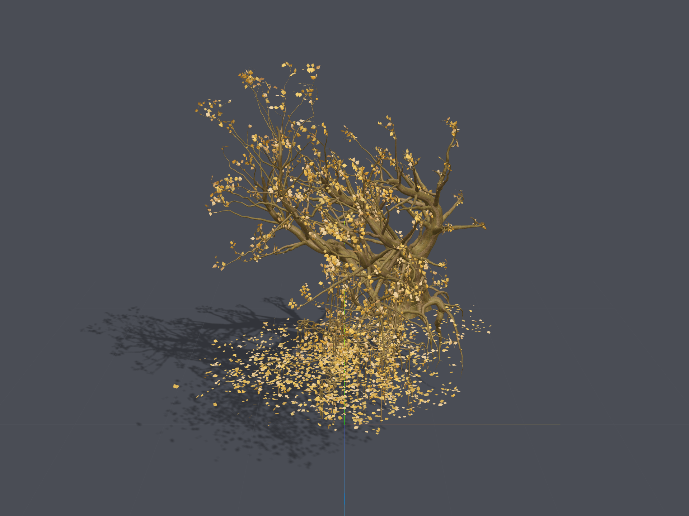
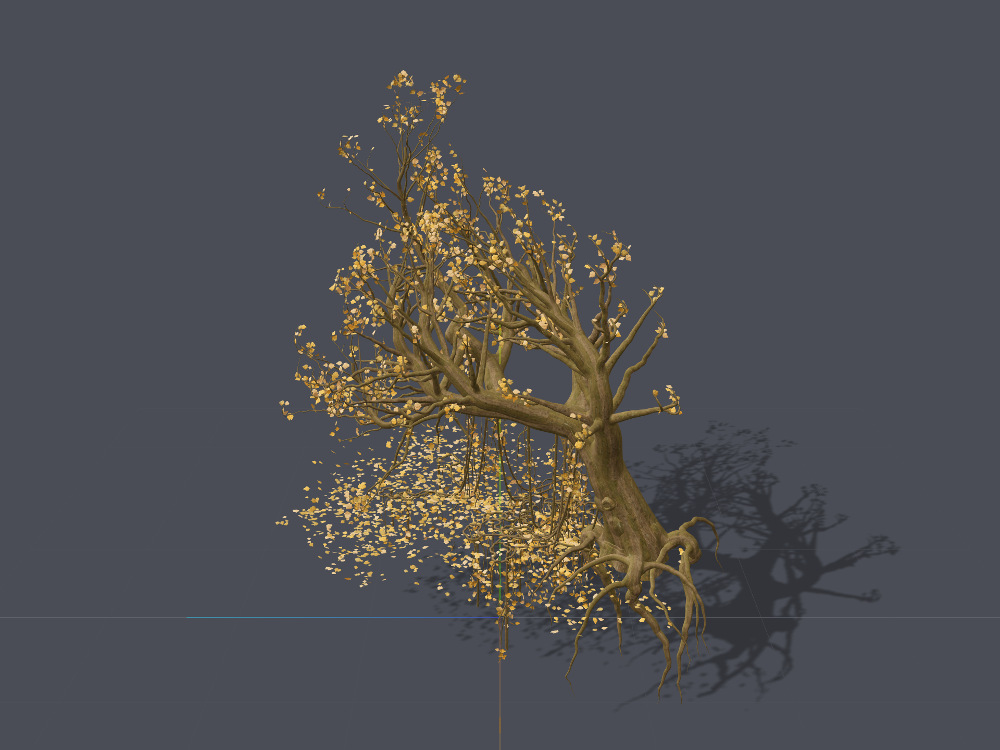
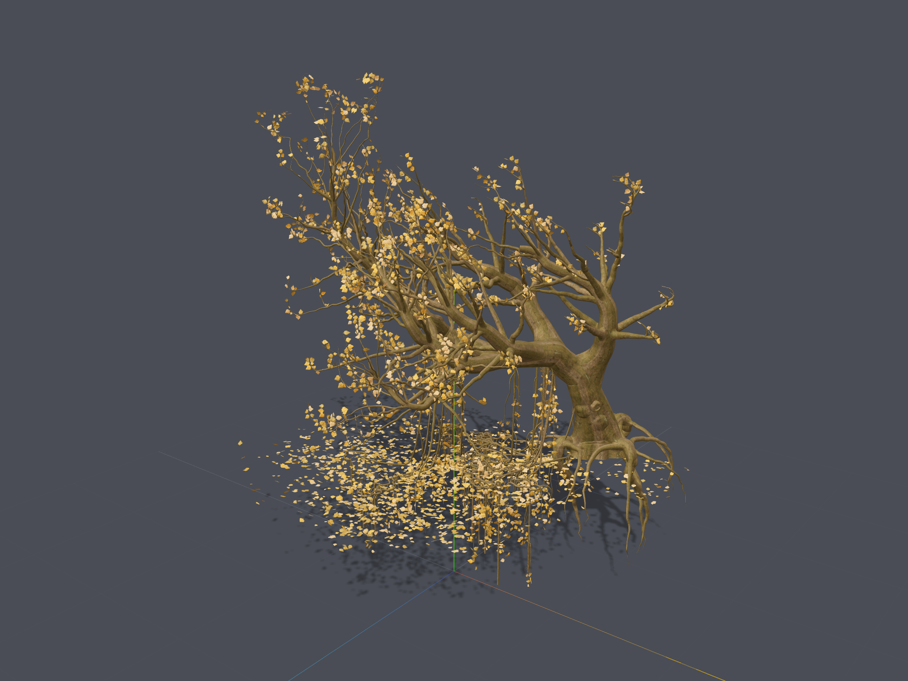

**What it is.** A gnarled, broad-canopied ginkgo in full autumn gold, with a thick buttressed
trunk, exposed surface roots, trailing vine strands and a scattered carpet of fallen leaves
modelled as separate geometry.

**Art style.** Stylized-realistic. The bark is sculpted with real silhouette detail rather than
normal-mapped, the leaves are individual textured cards, and the whole thing reads as
hand-authored game art rather than a scan. Material quality is the best in the set: proper
baseColor + normal + metallicRoughness across all five materials.

**Mood fit — excellent, arguably the single best asset here.** The aged-gold leaf colour is
almost exactly the accent you described, and the bare upper branches silhouette beautifully
against mist. This is a hero asset.

**Concerns.** 2.75 M triangles is far too many — this one file is 36% of the entire set's
geometry. A large share is the fallen-leaf carpet, which is near-invisible from most camera
angles. Optimization cut it 67% to 918 K, which is still heavy; I'd delete the leaf-litter
mesh separately and target 300–400 K. The 2048×4096 leaf atlases are also unusually tall.

---

### 2. `jinshan_temple_cishou_pagoda` — 85.02 MB → 3.79 MB

| | |
|---|---|
| Triangles / vertices | 945,644 / 809,614 |
| Meshes / materials / textures | 13 / 1 / 1 |
| Texture resolutions | 1 × **8192×8192** PNG, 49.5 MB — **340 MB VRAM** |
| Animations | none |
| Rigged | no |
| Bounding box | 327 × 318 × 407 units |
| Scale | ~407 u — centimetre-authored, scale ≈ ×0.1 |
| Pivot | below the mesh (originRel y = −0.075) — model floats above its own origin |
| Up axis | Y |
| Draw calls | 13 |

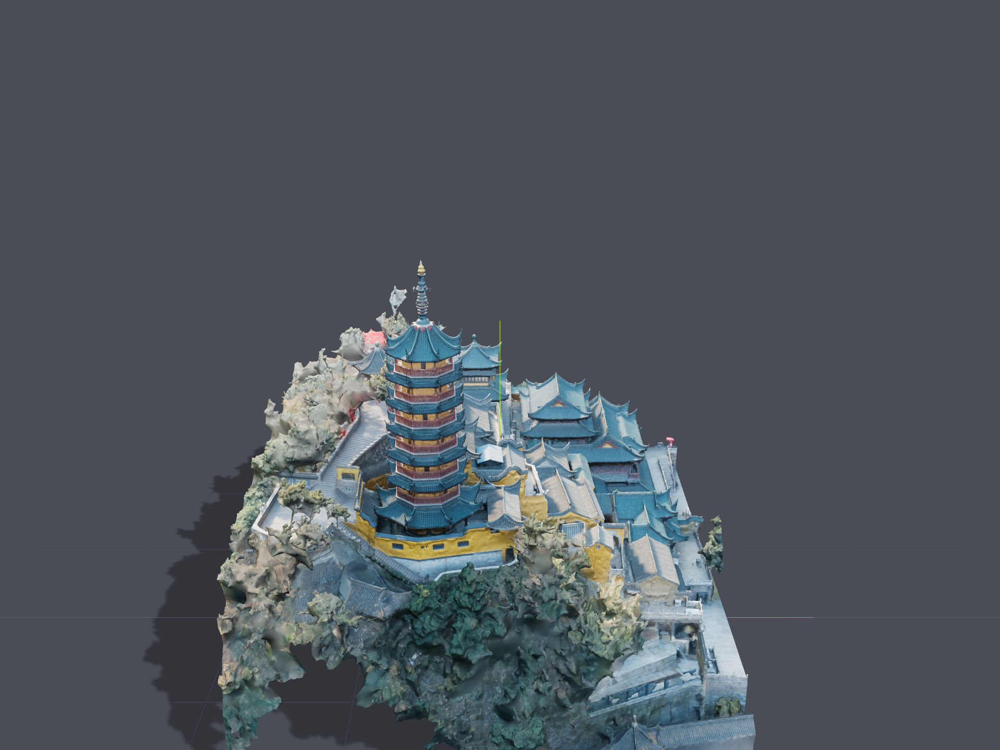
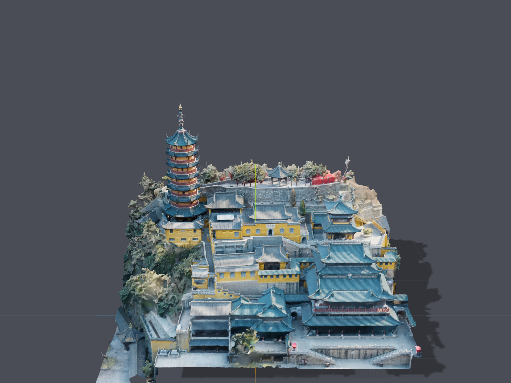
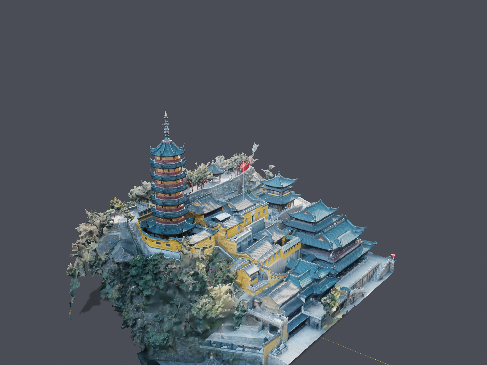

**What it is.** A drone-photogrammetry capture of the real Jinshan Temple complex at Zhenjiang —
a multi-storey blue-and-ochre pagoda crowning a hillside of ochre-walled halls, grey tiled roofs,
terraces, staircases and dense vegetation.

**Art style.** Photogrammetry. Everything is baked into a single unlit-ish 8K albedo; there are
no normal or roughness maps, so it will not respond to your lighting — it carries its own
captured daylight. Close up the vegetation dissolves into the melted, tattered blobs typical of
foliage scans, and the mesh boundary is a ragged torn edge.

**Mood fit — very strong at distance, poor up close.** As a silhouette emerging from mist on a
far ridge it is spectacular and instantly reads as "ancient Chinese mountain temple." The
teal-and-gold palette already sits close to your target. But do not fly the camera into it.

**Concerns.** The 8K texture is the worst VRAM offender in the set. Being a single baked albedo,
it cannot take your gold rim-lighting — you will need to fake atmosphere with fog, colour
grading and a vignette rather than real lights. The torn boundary must be hidden by fog or a
foreground element. Optimization barely reduced triangles (−4%) because scan meshes don't
simplify well without visible damage; the win here is entirely in the texture (340 → 21 MB VRAM).

---

### 3. `buddhist_temple_-_china` — 65.95 MB → 2.51 MB

| | |
|---|---|
| Triangles / vertices | 1,234,918 / 861,115 |
| Meshes / materials / textures | 14 / 1 / 1 (`KHR_materials_unlit`) |
| Texture resolutions | 1 × **8192×8192** JPEG, 25.5 MB — **340 MB VRAM** |
| Animations | none |
| Rigged | no |
| Bounding box | 110.5 × 56.2 × 127.4 units |
| Scale | ~127 u — scale ≈ ×0.3 |
| Pivot | **outside the bounding box entirely** (originRel y = 1.34) |
| Up axis | Y, but **tilted** — root quaternion is an arbitrary rotation, not the standard correction |
| Draw calls | 14 |

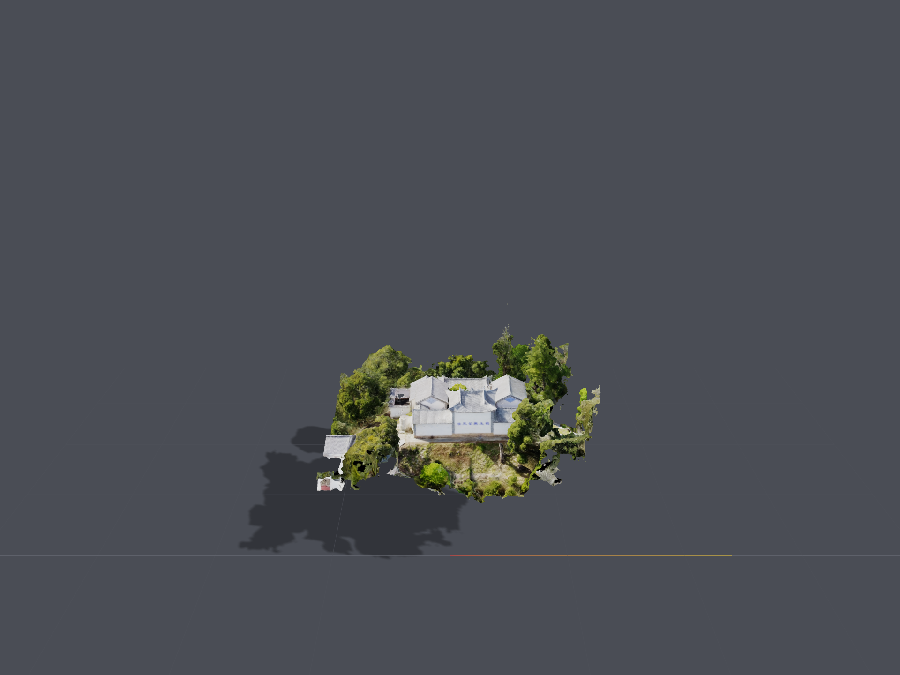
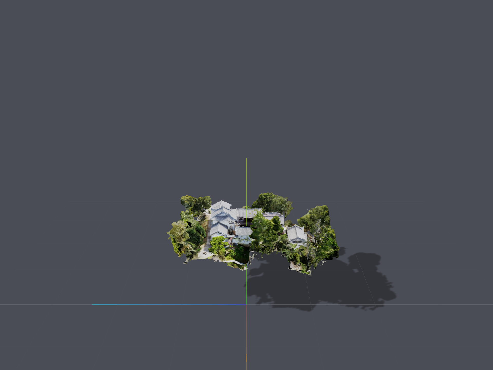
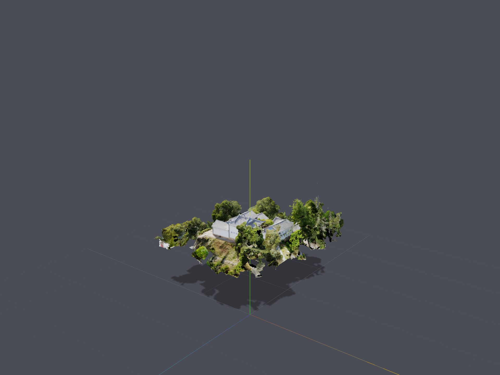

**What it is.** A small aerial photogrammetry capture of a white-walled, grey-roofed temple
compound almost entirely swallowed by dense green trees, sitting on a torn-edged terrain patch.

**Art style.** Photogrammetry, and noticeably lower-quality than the Jinshan scan — lower
effective resolution, heavier foliage melt, less recognisable architecture. It is flagged
`KHR_materials_unlit`, so it is fully self-lit and completely ignores scene lighting.

**Mood fit — weak.** The dominant colour is bright summer green, which is the opposite of a
dark, misty, gold-accented palette. The buildings are barely visible through the canopy, so it
does not read as "temple" at a glance. It would need heavy desaturation and colour grading, and
even then only works as a distant valley floor far below the camera.

**Concerns.** Unlit means your art direction cannot touch it without a custom shader. The
arbitrary root tilt must be fixed. The pivot is outside the mesh. 1.23 M triangles for an asset
this low-value is a bad trade. This is the weakest usable asset in the set.

---

### 4. `thunderclap_temple` — 50.23 MB → 3.51 MB — **Not usable**

| | |
|---|---|
| Triangles / vertices | 437,840 / 878,492 |
| Meshes / materials / textures | 14 / 1 / 3 |
| Texture resolutions | 4096² JPEG + 2048² + 512² PNG — **108 MB VRAM** |
| Animations | none |
| Rigged | no |
| Bounding box | 34.5 × 23.2 × 36.5 units |
| Scale | root node carries a **×50 scale** |
| Pivot | at base, horizontally centred — the cleanest pivot in the set |
| Up axis | Y |
| Draw calls | 14 |

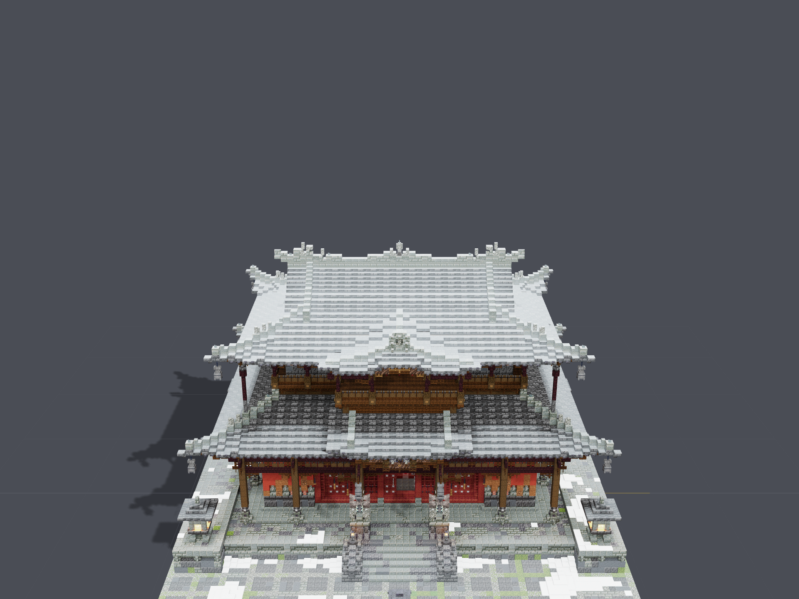
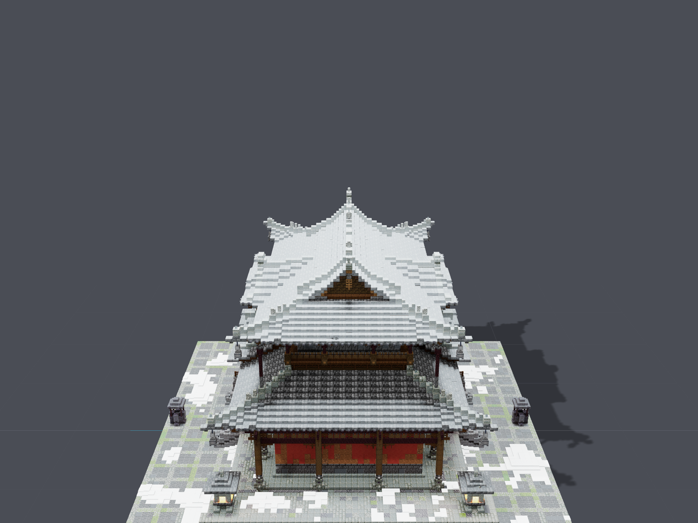
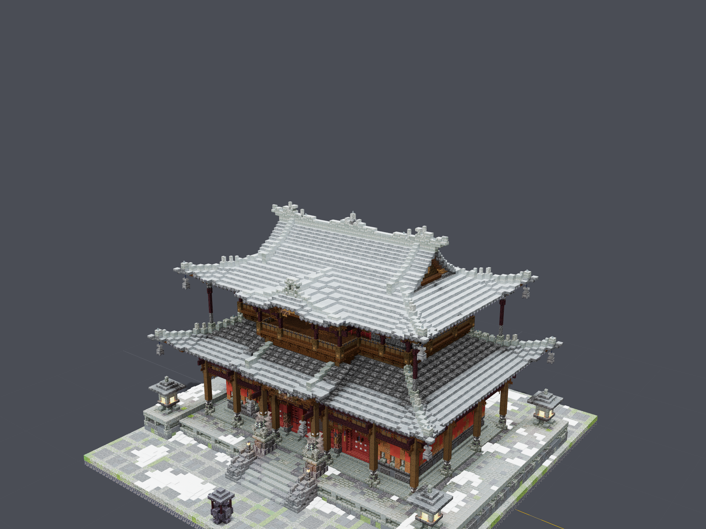

**What it is.** Despite the Journey-to-the-West name, this is a **Minecraft voxel build** —
a two-tier Chinese hall rendered entirely in 1×1 cubes, with blocky stair-stepped roofs,
pixel-texture blocks, voxel lanterns and a flat grass-and-slab platform.

**Art style.** Voxel/blocky, with 16×16-pixel block textures.

**Mood fit — none.** This cannot be reconciled with a cinematic realistic or stylized-realistic
site. Mixing it with the photogrammetry temples or the ginkgo tree would look like a bug. The
irony is that technically it is one of the better-behaved files: clean pivot, modest triangle
count, no simplification damage (0% — voxel geometry is already minimal).

**Verdict: drop it.** If you genuinely want the Thunderclap Monastery beat, source a different
model. Keeping this one is not an optimization problem, it is an art-direction problem.

---

### 5. `chinese_pagoda` — 44.50 MB → 2.43 MB

| | |
|---|---|
| Triangles / vertices | 541,810 / 341,540 |
| Meshes / materials / textures | 6 / 2 / 2 |
| Texture resolutions | **8192×8192** JPEG + 2048² JPEG — **362 MB VRAM** (highest in the set) |
| Animations | none |
| Rigged | no |
| Bounding box | 32.9 × 33.2 × 40.8 units |
| Scale | metres-ish, ~41 u |
| Pivot | offset inside bounds (y 0.28) |
| Up axis | Y |
| Draw calls | 6 |

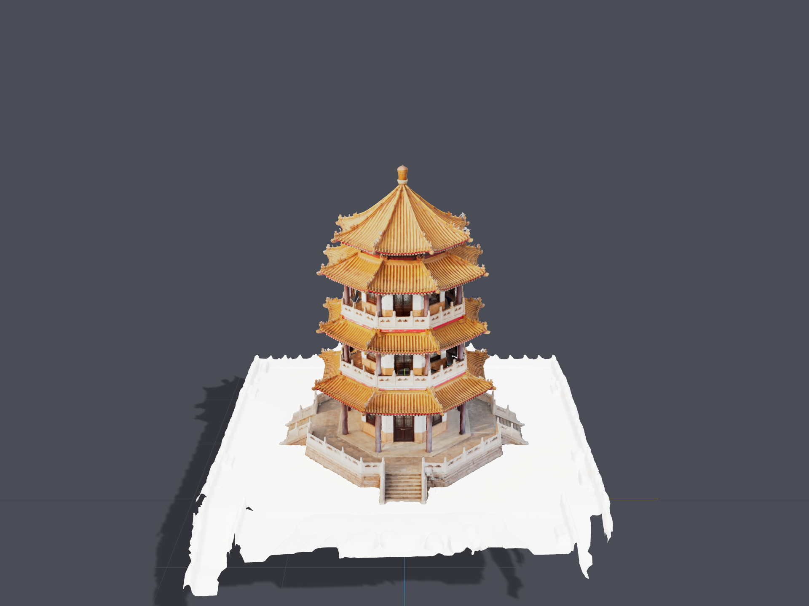
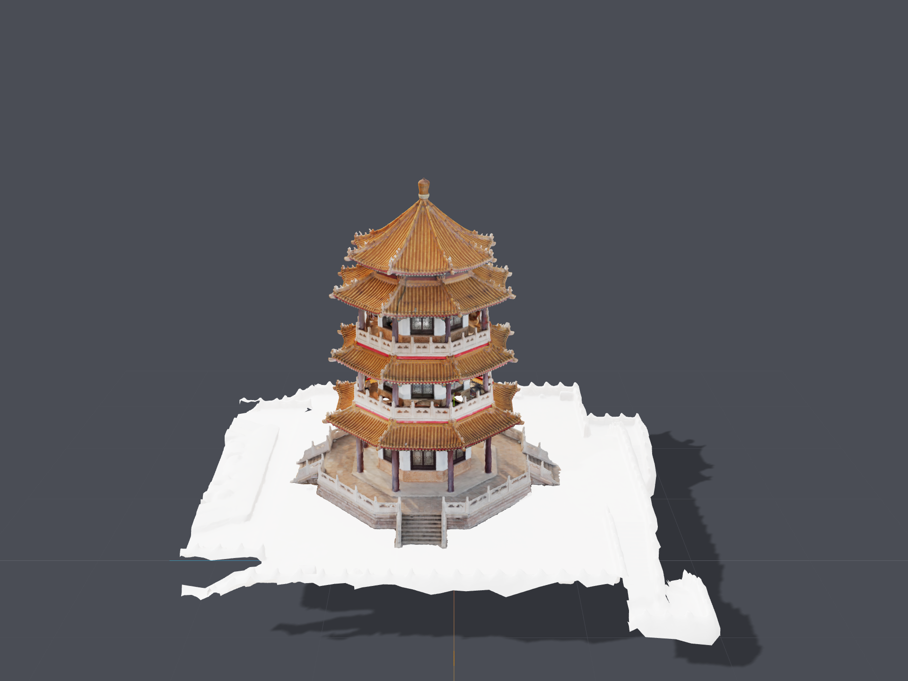
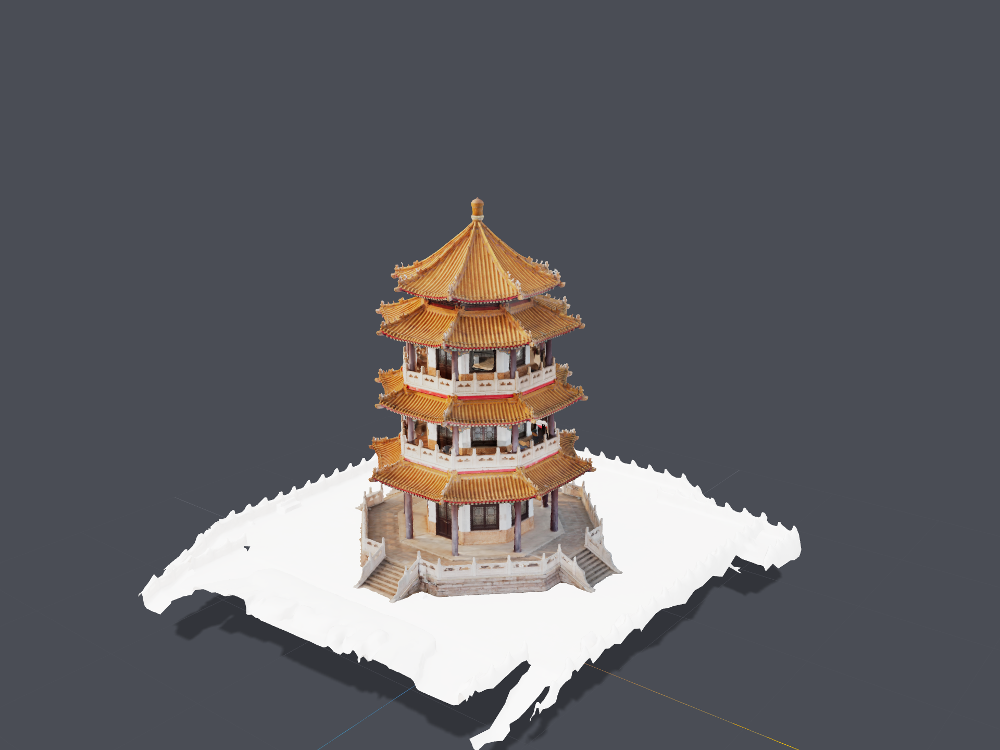

**What it is.** A photogrammetry capture of an octagonal four-tier pagoda with glazed
golden-yellow tiled roofs, white stone balustrades, red trim and dark timber columns, standing
on a stone terrace — then a large, flat, pure-white ground slab extending well beyond it.

**Art style.** Photogrammetry, but a much cleaner capture than the other two: the architecture
is crisp, the roof tiles are legible, the railings hold their shape, and there is no foliage
melt because there is almost no foliage.

**Mood fit — good, and the best isolated building in the set.** The golden roofs are already
your aged-gold accent. Being an isolated object rather than a whole hillside, you can orbit it,
rise past it and silhouette it freely. It is the most directable architecture you have.

**Concerns.** The white ground slab is a serious problem — it is bright, flat, obviously a
capture artefact, and would need to be deleted as a separate mesh before use (it is one of the
6 primitives, so this is a clean extraction). The 8K texture is the largest VRAM cost in the
whole set. Like the other scans it is baked-lit and won't respond to your lighting.
Post-optimization this becomes a genuinely cheap, genuinely good asset.

---

### 6. `black_myth_wukong_-_ling_xu_zi_static` — 37.28 MB → 3.56 MB

| | |
|---|---|
| Triangles / vertices | 172,138 / 117,497 |
| Meshes / materials / textures | 5 / 5 / 8 |
| Texture resolutions | 6 × 2048², 2 × 1024² PNG, 27.9 MB — **138 MB VRAM** |
| Animations | **none** |
| Rigged | **yes** — 2 skins, 638 joints |
| Bounding box | 1223 × 1684 × 1117 units (**inflated — see below**) |
| Scale | ~1684 u — centimetre-authored, scale ≈ ×0.01 |
| Pivot | offset inside bounds (x 0.69, z 0.99) |
| Up axis | Y |
| Draw calls | 5 |

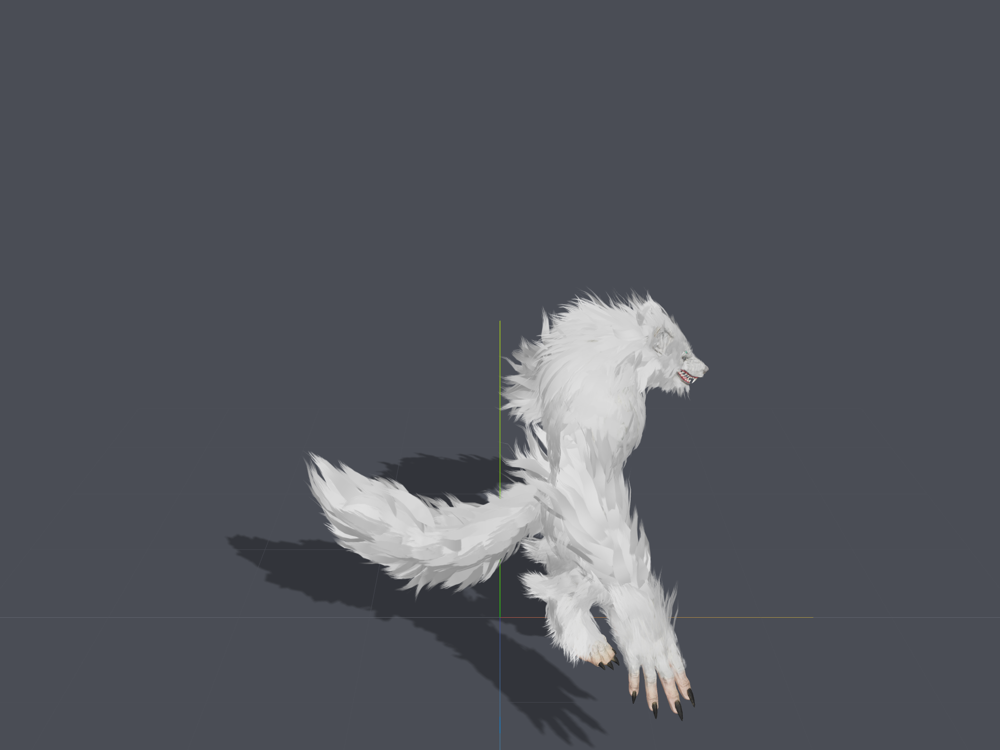
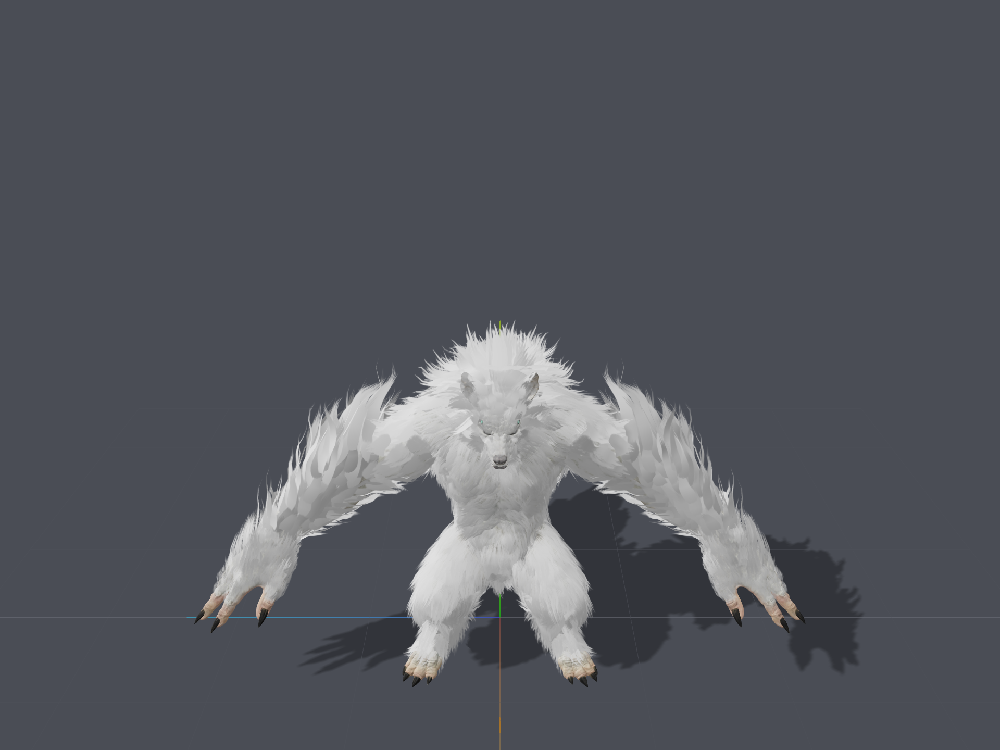
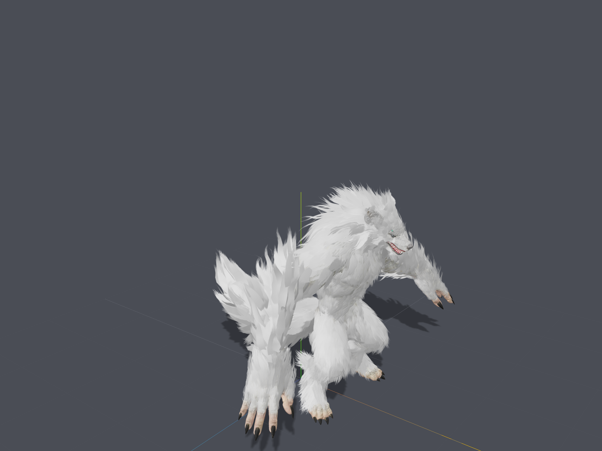

**What it is.** Lingxuzi, the white-furred wolf/ape beast boss from Black Myth: Wukong — a
hunched, long-armed quadruped with an enormous feathered mane, a thick plumed tail, humanoid
hands ending in black claws, and a snarling open-mouthed head.

**Art style.** Game-realistic, ripped from the shipped game. The fur is built from layered
textured card geometry rather than shells, which is why 172 K triangles buys this much
silhouette. Materials are baseColor + normal only — no roughness or metalness maps, so it
renders flat-ish under PBR lighting.

**Mood fit — strong concept, wrong value.** As the Guardian it is perfect casting: it is
literally a Black Myth boss. But it is rendered almost pure white, which fights a dark misty
palette badly and blows out under any strong key light. You will need to tint the baseColor
toward grey-blue and lean hard on rim lighting to make it read.

**Concerns.** Two real defects. First, **stray detached geometry**: a second copy of the head
floats far from the body (clearly visible at the left edge of the front screenshot), inflating
the bounding box roughly 3× and breaking any automatic framing or centring. This must be
deleted. Second, **it is rigged but has no animation clips** — 638 joints of skeleton with
nothing to play. For an "awakening" beat you would have to author the motion yourself by driving
bones, or settle for a scroll-driven transform of the whole mesh. The skinning cost is also
paid every frame for no benefit as-is.

---

### 7. `anubis_divine_temple` — 33.42 MB → 4.82 MB — **Not usable**

| | |
|---|---|
| Triangles / vertices | 499,119 / 387,432 |
| Meshes / materials / textures | 114 / 21 / 21 |
| Texture resolutions | 2 × 2048², 19 × 1024² PNG — **144 MB VRAM** |
| Animations | none |
| Rigged | no |
| Bounding box | 1473 × 1454 × 1473 units |
| Scale | ~1473 u — scale ≈ ×0.01 |
| Pivot | fully centred |
| Up axis | Y |
| Draw calls | 114 (highest in the set) |

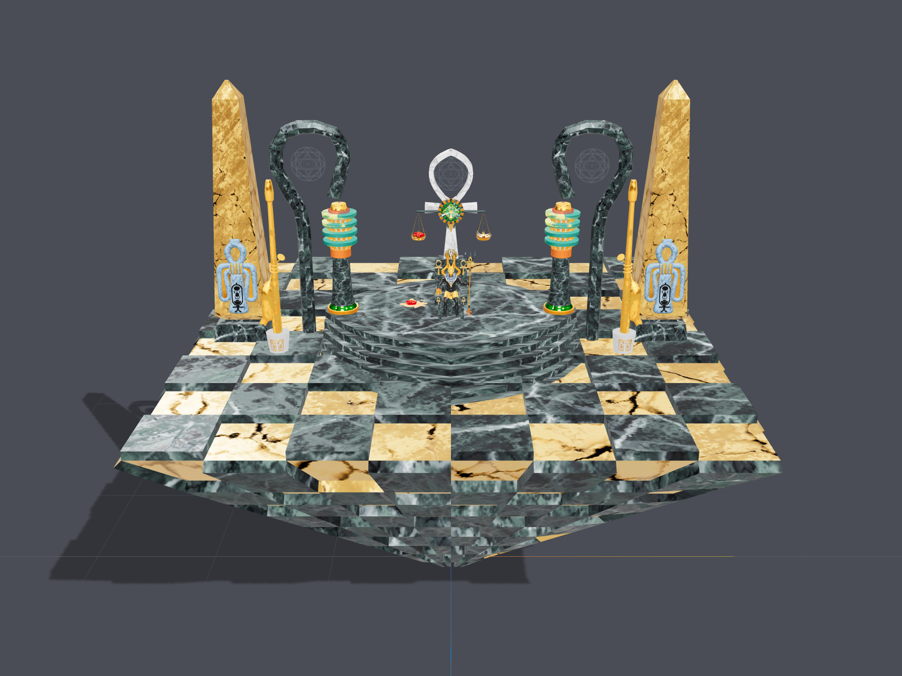
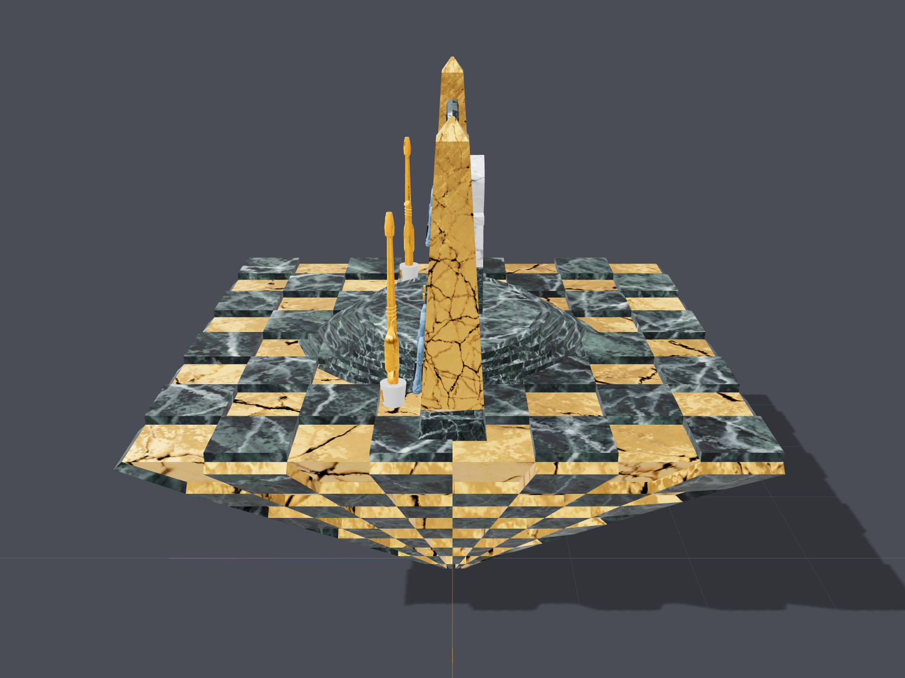
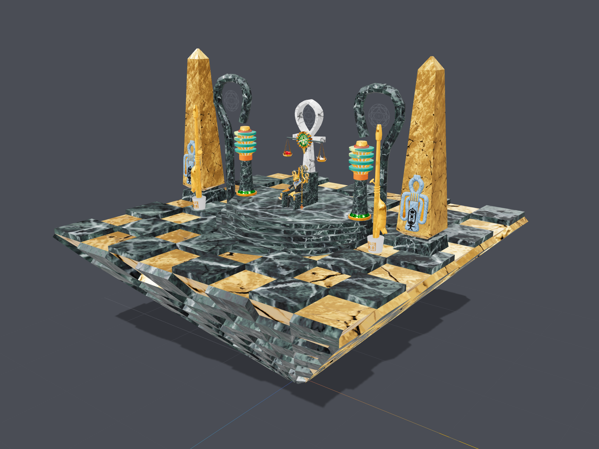

**What it is.** An **Ancient Egyptian** diorama — a green-and-gold marble checkerboard platform
carrying gold obelisks with hieroglyphic cartouches, a white marble ankh holding the scales of
Ma'at, lotus-capital columns, crook-and-flail staves, and a small seated Anubis figure.

**Art style.** Stylized low-detail, leaning on glossy procedural marble and gold materials.
It uses clearcoat, transmission, specular and emissive-strength extensions, so it is the most
materially sophisticated file here — and it looks like a chess-set render, not a mythic ruin.

**Mood fit — none.** This is the wrong mythology entirely. Egyptian iconography (ankh,
obelisk, hieroglyphs, Anubis) is unmistakable and cannot be dressed up as Chinese.

**Verdict: drop it.** Worth noting only that its *materials* are instructive — the aged-gold
and dark-veined-marble shaders are close to the look you want, and are worth studying even as
you discard the geometry. 114 draw calls would also have been a problem.

---

### 8. `dragon_with_pearl` — 26.28 MB → 1.87 MB

| | |
|---|---|
| Triangles / vertices | 999,634 / 648,060 |
| Meshes / materials / textures | 10 / 1 / **0** |
| Texture resolutions | none — **0 MB VRAM** |
| Animations | none |
| Rigged | no |
| Bounding box | 139.9 × 185.9 × 145.3 units |
| Scale | ~186 u — scale ≈ ×0.05 |
| Pivot | fully centred |
| Up axis | Y |
| Draw calls | 10 |

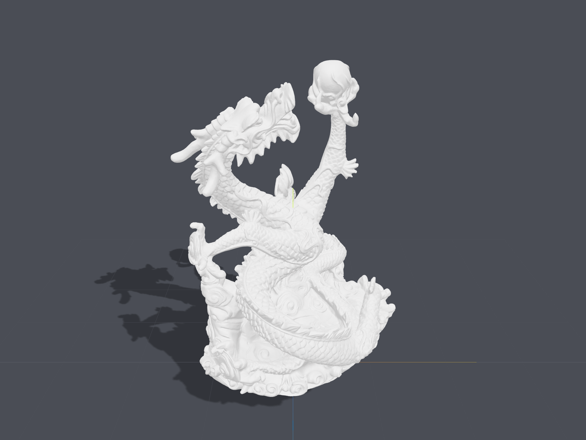
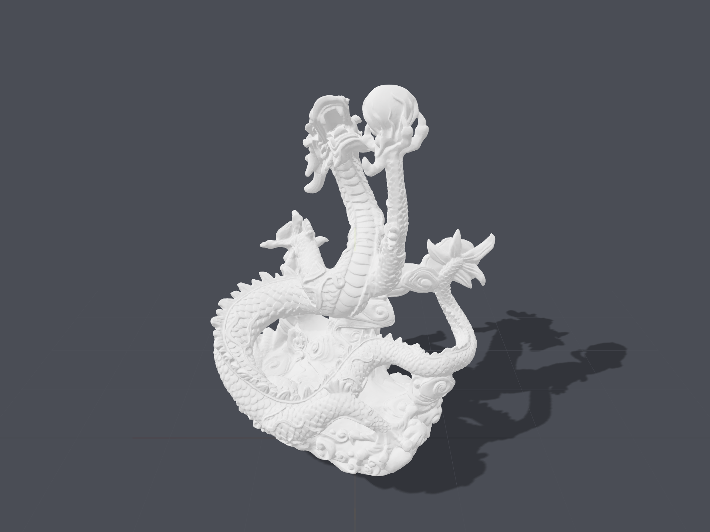
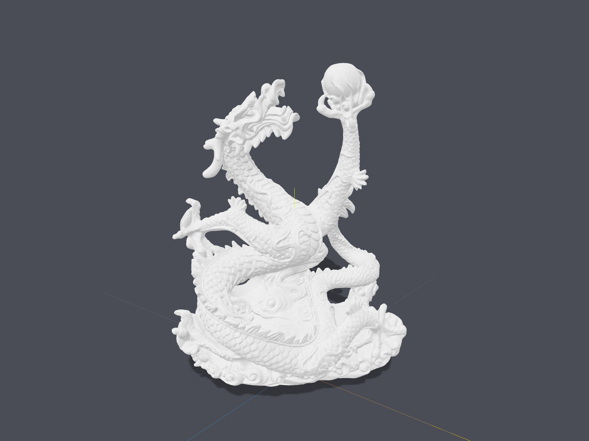

**What it is.** A classical Chinese dragon coiled upward through stylised cloud scrollwork,
head thrown back with jaws open, one foreclaw raised holding the flaming pearl. Fully sculpted
scales, mane, whiskers, horns and clawed feet.

**Art style.** A high-detail sculpt with **no textures and no materials beyond a single default
white** — this is a 3D-print / statue asset. One million triangles of pure geometric detail.

**Mood fit — excellent, and uniquely flexible.** Because it carries no baked colour, it takes
*whatever material you give it*: weathered jade, dark bronze with gold leaf in the crevices,
wet black stone, or a flat ink silhouette. It is the only asset in the set that will accept your
art direction wholesale rather than fighting it. The "dragon chasing the pearl" motif is also
exactly the right iconography.

**Concerns.** 1 M triangles for an untextured sculpt is the worst detail-per-triangle ratio here
— all that geometry exists because there is no normal map doing the work. The right fix is to
decimate hard and bake the lost detail into a normal map; optimization alone only reached 761 K.
It will also need a real material authored from scratch, plus AO, or it will read as flat white
plastic. Budget art time for this one — it is worth it.

---

### 9. `chinese_dragon` — 25.50 MB → 10.02 MB — **the only animated asset**

| | |
|---|---|
| Triangles / vertices | 50,553 / 28,189 |
| Meshes / materials / textures | 2 / 2 / 4 |
| Texture resolutions | 3 × 2048², 1 × 512² PNG — **65 MB VRAM** |
| Animations | **1 — "Take 001", 57.5 s, 559 channels, LINEAR** |
| Rigged | **yes** — 1 skin, 273 joints |
| Bounding box | 780 × 542 × **4969** units |
| Scale | ~4969 u — the largest in the set, scale ≈ ×0.004 |
| Pivot | at base, horizontally offset |
| Up axis | Y |
| Draw calls | 2 |

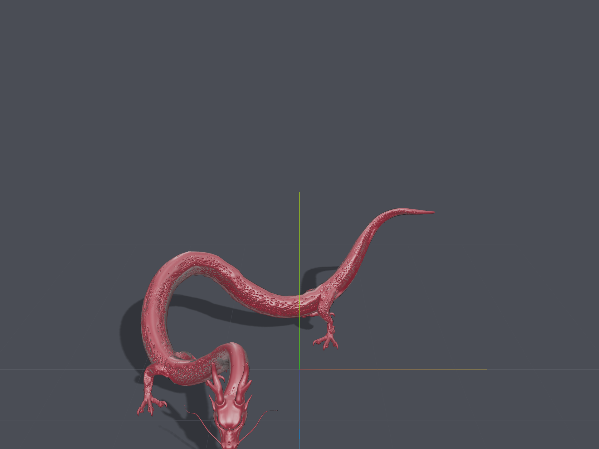
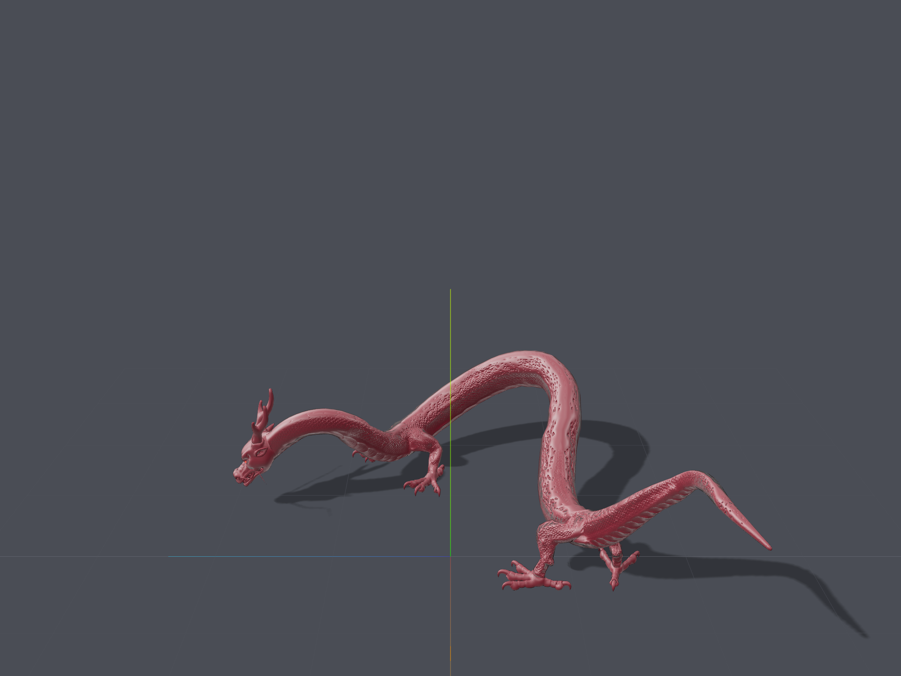
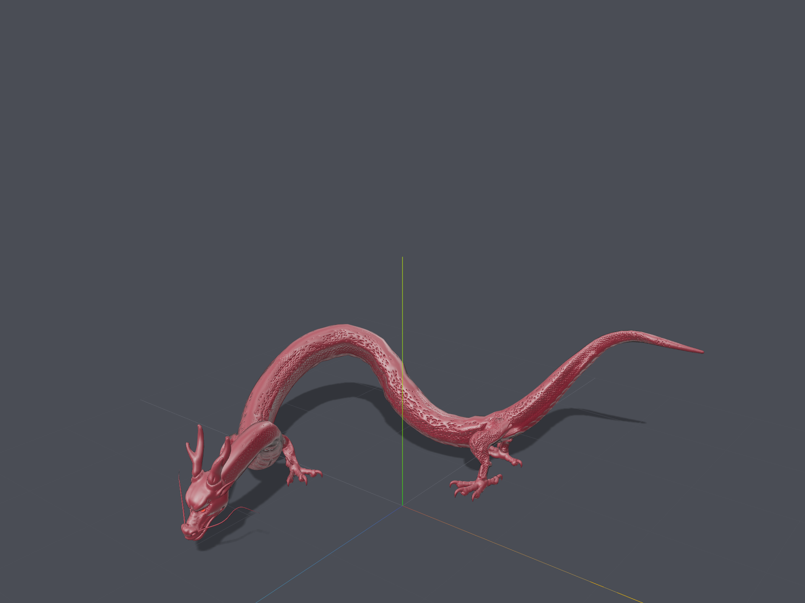

**What it is.** A long serpentine Eastern dragon — slender snaking body nearly 5000 units
end to end, four small clawed limbs, antler horns, trailing whiskers — rigged along its length
with 273 joints and carrying a near-minute-long animation.

**Art style.** Mid-detail game asset. In the preview it renders as a flat dusty-rose/magenta
with visible scale sculpting but very little tonal variation, despite having four textures
(baseColor, normal, emissive, plus clearcoat). The emissive map suggests it was authored to glow
somewhere, which could be useful.

**Mood fit — good shape, bad colour.** The serpentine silhouette coiling through mist is exactly
the Chapter 5 image you want, and **the animation makes it the only asset that can actually
"awaken" on its own**. But the pink-magenta base colour is the furthest from your palette of
anything here; it needs retinting to ink-black, jade or aged bronze.

**Concerns.** Optimization only managed −61%, by far the worst ratio in the set, because the
animation data doesn't compress: 559 channels × 57.5 s of LINEAR keyframes dominates the file.
At 10 MB it is now the **largest** optimized asset despite having the second-fewest triangles.
Resample the animation (`gltf-transform resample`) and consider trimming to a 5–8 s loop — you
will not scroll through 57 seconds. Simplification also cut it 41%, which is risky on a skinned
mesh: verify the deformation still looks right before shipping the optimized version. Its 4969-unit
length also means it will dominate any scene it enters.

---

### 10. `stone_lion` — 19.70 MB → 1.65 MB — **Ready**

| | |
|---|---|
| Triangles / vertices | 22,329 / 13,060 |
| Meshes / materials / textures | 1 / 1 / 3 |
| Texture resolutions | 3 × 2048² PNG (baseColor, normal, metallicRoughness, occlusion) — **64 MB VRAM** |
| Animations | none |
| Rigged | no |
| Bounding box | 69.5 × 108.7 × 95.1 units |
| Scale | ~109 u — scale ≈ ×0.02 |
| Pivot | **at base, horizontally centred — clean, drop-in placeable** |
| Up axis | Y |
| Draw calls | **1** |

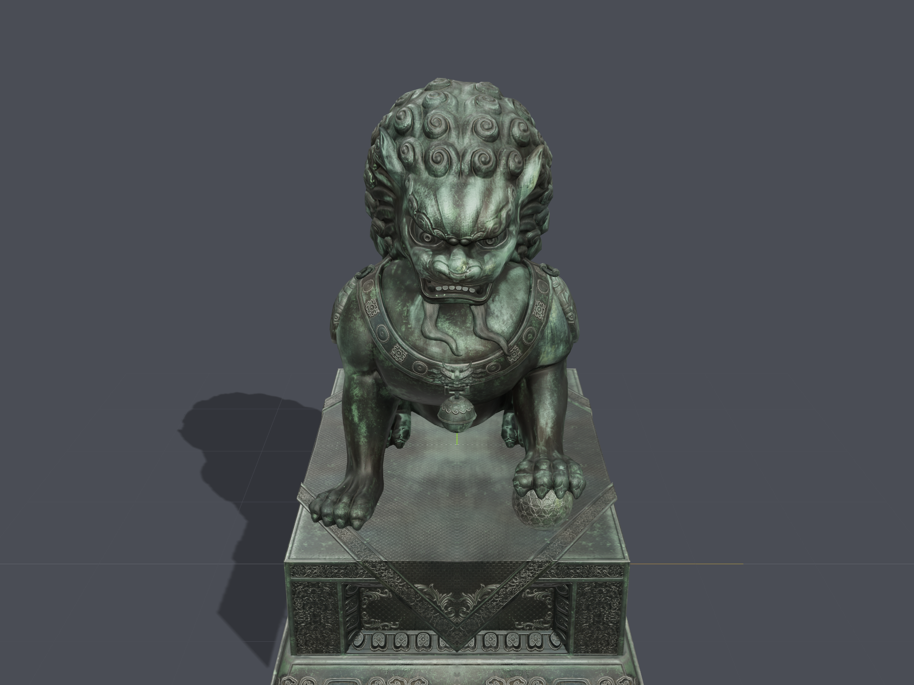
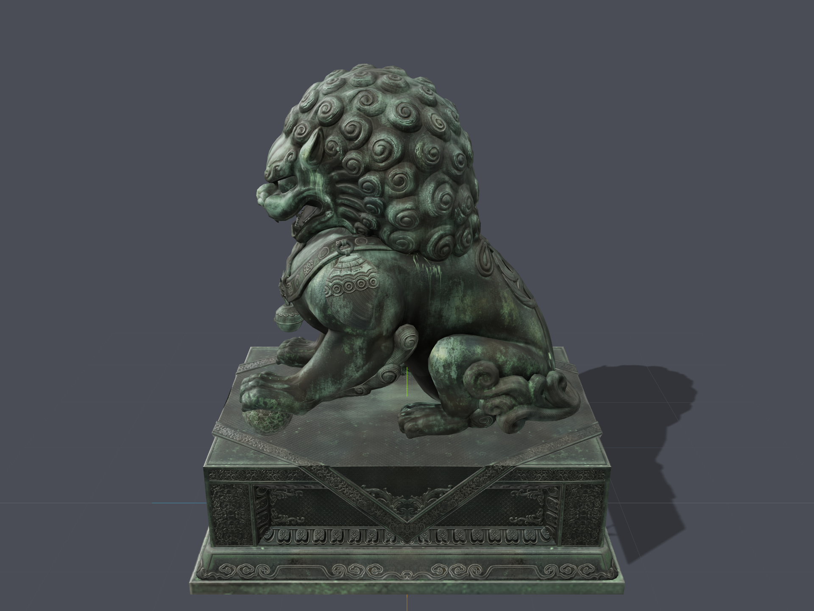
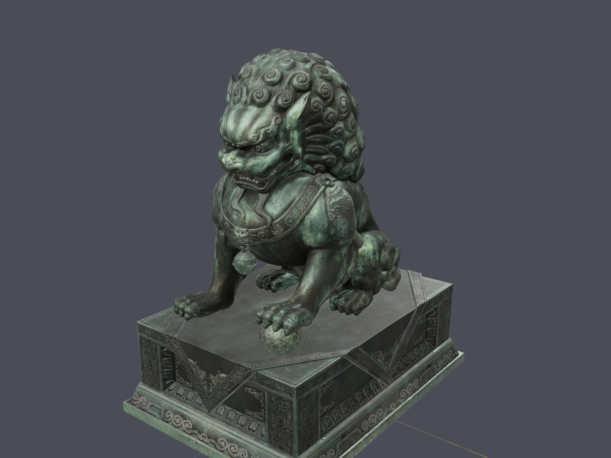

**What it is.** A guardian lion (*shishi*) in weathered dark green-grey stone — curled mane,
bared fangs, one paw forward, bell-and-tassel collar — on a carved rectangular plinth with
relief panels.

**Art style.** Realistic, and **the best-behaved asset in the set**. One mesh, one material, a
full PBR texture set including occlusion, a clean base-centred pivot, 22 K triangles, **one draw
call**. Whoever made this knew what they were doing.

**Mood fit — excellent.** The weathered dark-green patina with grime in the crevices is
already almost exactly your palette. Lit from behind with gold rim light and standing in mist,
this is a finished Chapter 2 image with no further art needed. Mirror it for a flanking pair.

**Concerns.** Essentially none. Three 2048² maps are slightly generous for a prop this small —
1024² would halve the VRAM with no visible loss. Use it freely.

---

### 11. `staff_of_homa` — 6.99 MB → 0.11 MB

| | |
|---|---|
| Triangles / vertices | 13,766 / 13,640 |
| Meshes / materials / textures | 31 / **31** / **30** |
| Texture resolutions | 30 × 1024×512 PNG, all ~239 KB — **72 MB VRAM** |
| Animations | none |
| Rigged | no |
| Bounding box | 13.0 × 19.0 × 1.4 units |
| Scale | ~19 u |
| Pivot | **at base, horizontally centred — clean** |
| Up axis | Y |
| Draw calls | **31** |

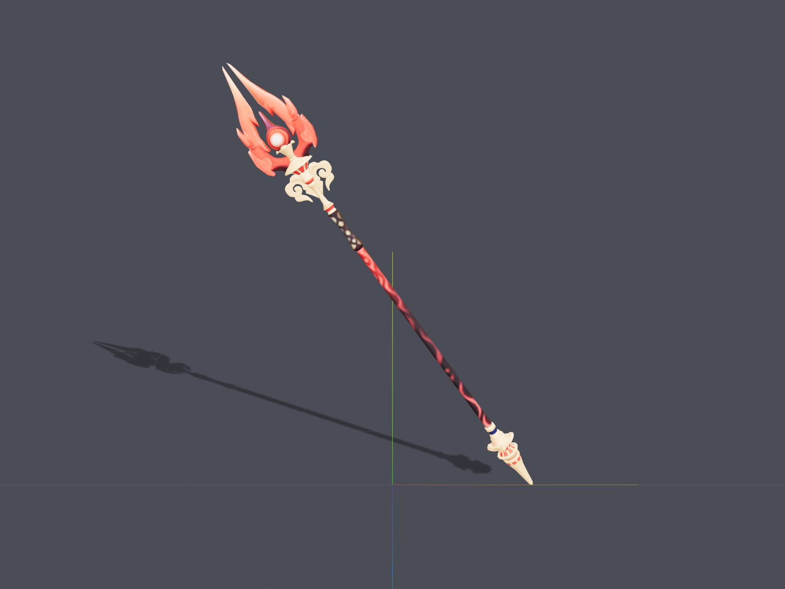
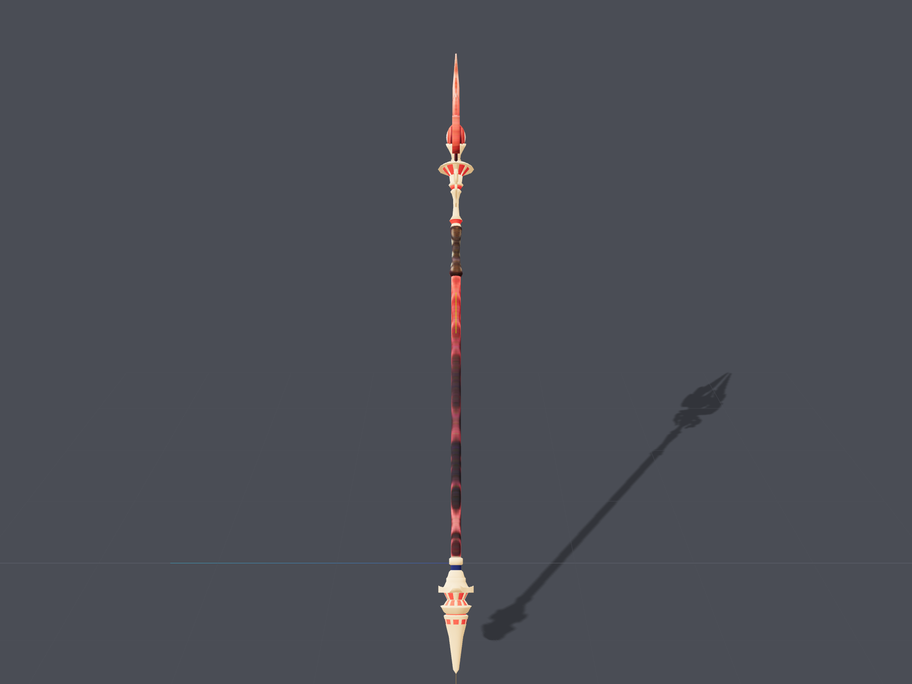
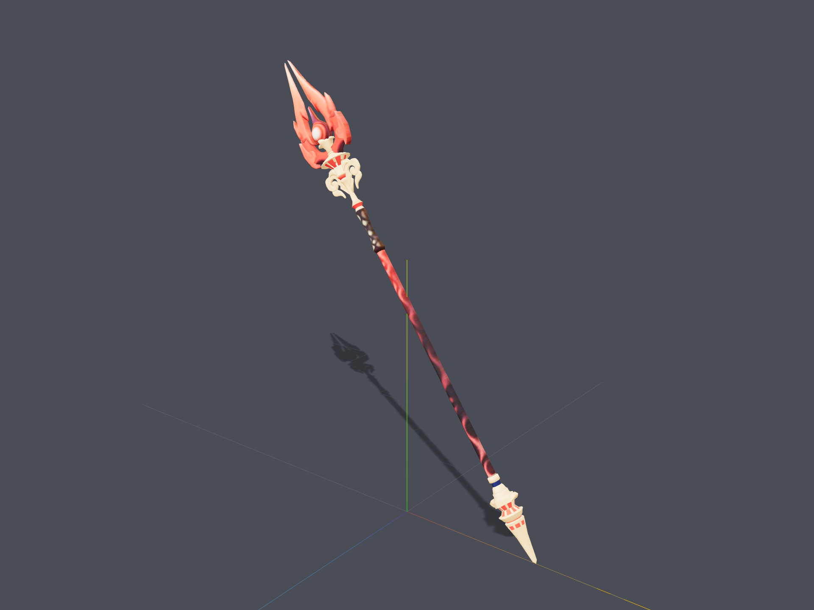

**What it is.** Not a Wukong staff — this is **Staff of Homa, the polearm from Genshin Impact**:
a slender dark-red shaft with pale cream cloud-scroll fittings, a coral-red flame-shaped blade
cradling a glowing white orb, and a cream finial.

**Art style.** Anime/cel-stylized, with flat bright coral-red and cream colours and no surface
wear. Clean, cheap geometry.

**Mood fit — poor as-is.** The palette is bright coral and cream; yours is ink, mist and aged
gold. The Genshin silhouette is also recognisable enough that fans will clock it, which
undercuts a Wukong-inspired site. And narratively it is wrong: Chapter 4 wants the **Ruyi Jingu
Bang**, a plain dark iron staff with gold end-caps, not an ornate flame polearm.

**Concerns.** The material setup is pathological: **31 materials and 30 near-identical
1024×512 textures for 13.7 K triangles**, costing 31 draw calls for a single prop. This is a
model that was never merged after assembly. Optimization fixed it dramatically (down to 3
materials, 2 textures, 0.11 MB — a 98% cut, the best in the set), so the *optimized* version is
fine technically.

**Verdict: usable as a temporary placeholder to block out the Chapter 4 hero moment, but plan to
replace it.** Keep the staging you build around it; swap the asset.

---

### 12. `chinese_dragon_fan` — 6.77 MB → 0.73 MB — **Ready**

| | |
|---|---|
| Triangles / vertices | 26,144 / 21,189 |
| Meshes / materials / textures | 5 / 3 / 9 |
| Texture resolutions | 8 × 2048², 1 smaller — **192 MB VRAM** (4 are ~1 KB placeholders) |
| Animations | none |
| Rigged | no |
| Bounding box | 40.2 × 24.8 × 25.4 units |
| Scale | ~40 u |
| Pivot | **outside the bounding box** (originRel z = 1.17) |
| Up axis | Y |
| Draw calls | 5 |

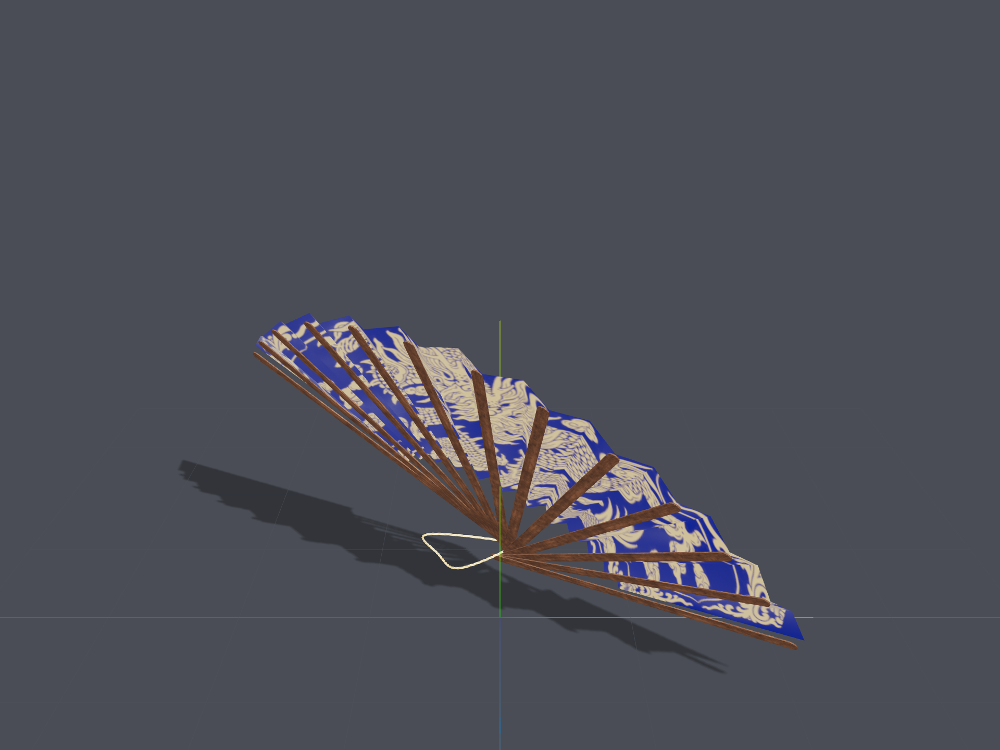
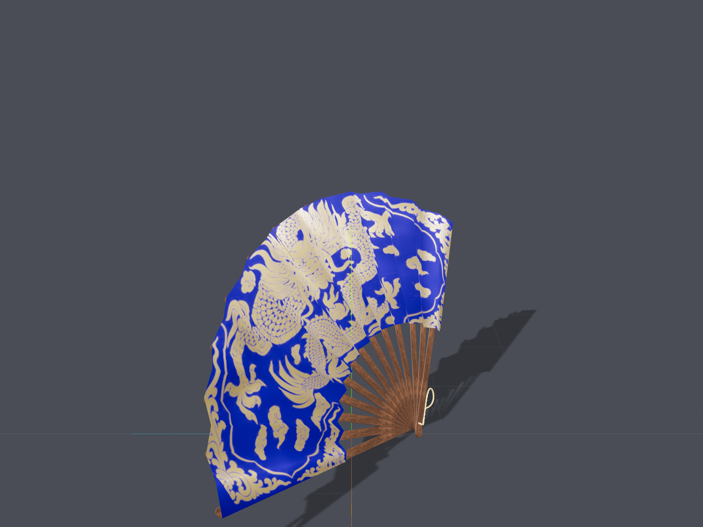
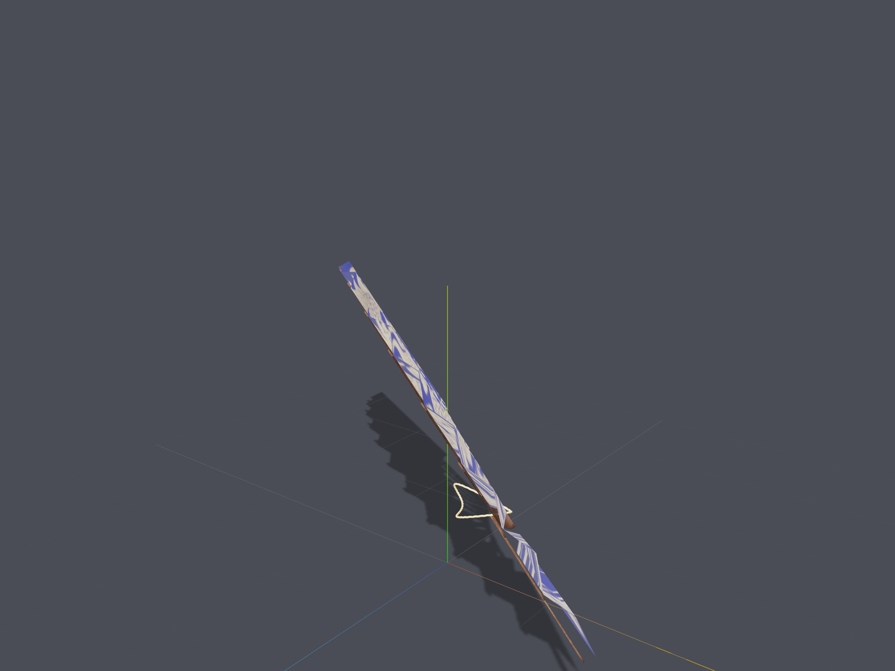

**What it is.** An open folding fan — wooden ribs fanning from a corded pivot, the leaf painted
with a cream dragon writhing across cobalt blue, in a porcelain blue-and-white style.

**Art style.** Clean stylized prop. The leaf is flat plane geometry with the dragon painted
into the texture rather than modelled.

**Mood fit — moderate.** The cobalt blue is off-palette and the object is small-scale and
domestic rather than mythic. But as a single floating ink-and-porcelain object drifting through
the Chapter 1 void, or as set dressing, it works. It is also the only asset carrying a painted
2D dragon motif, which suits an "ink" opening.

**Concerns.** Four of its nine 2048² textures contain ~1 KB of data — effectively blank
placeholder maps that still allocate full VRAM. Strip them. The pivot sits outside the mesh.
Flat planes mean it looks wrong edge-on, so control your camera angles.

---

### 13. `module_2_-_chinese_lantern` — 1.22 MB → 0.05 MB — **Ready**

| | |
|---|---|
| Triangles / vertices | 19,248 / 31,960 |
| Meshes / materials / textures | 24 / 6 / **0** (vertex colours) |
| Texture resolutions | none — **0 MB VRAM** |
| Animations | none |
| Rigged | no |
| Bounding box | 3.04 × 7.40 × 3.43 units |
| Scale | ~7.4 u — the smallest and most sensible in the set |
| Pivot | fully centred |
| Up axis | Y |
| Draw calls | 24 |

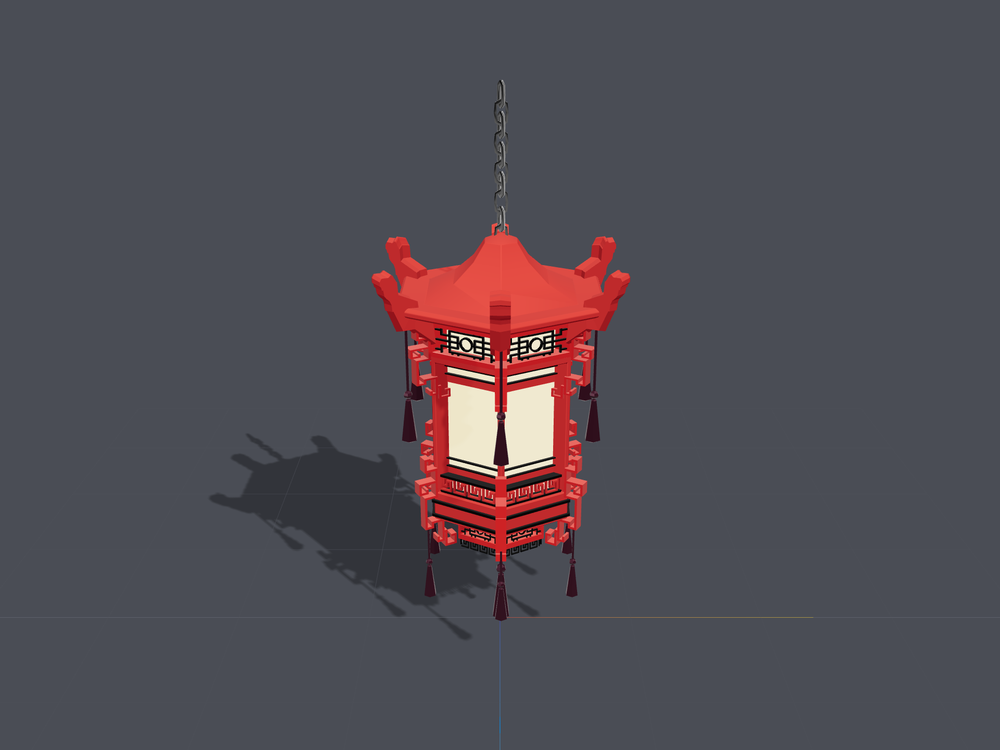
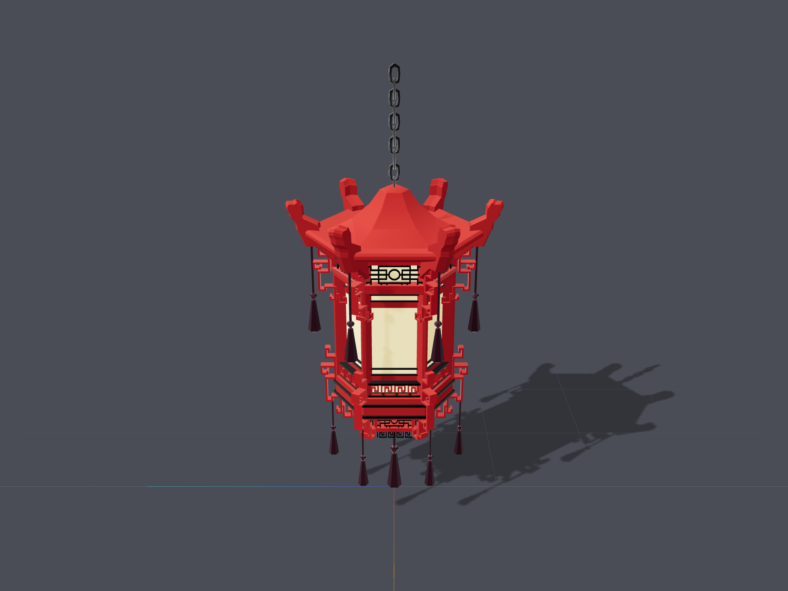
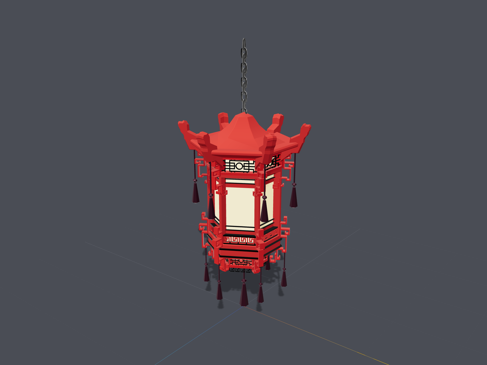

**What it is.** A hexagonal palace lantern — bright red tiered roof with upturned eaves, cream
paper panels framed by red fretwork, dark tassels hanging from each corner, suspended from a
chain.

**Art style.** Clean low-poly, flat-shaded, coloured entirely by material/vertex colour with no
textures at all. Crisp and well-made for what it is.

**Mood fit — good with one change.** The cream panels are *begging* to be emissive. Light these
from inside and scatter a dozen of them receding into fog and you have instant atmosphere and
depth cueing. The bright primary red is too saturated for your palette and should be darkened
toward lacquer/oxblood. The low-poly style is simple enough to read as deliberate rather than
cheap, unlike the Minecraft temple.

**Concerns.** Only that it is 24 separate primitives for a tiny object — 24 draw calls each. If
you instance a dozen of them, merge the geometry first. At **0.05 MB optimized** it is
essentially free. This is your best candidate for instanced background atmosphere.

---

## Web-readiness summary

### Measured optimization results

Run non-destructively into `./models-optimized/` with:

```
gltf-transform optimize <in> <out> --texture-compress webp --compress draco
```

Originals at the project root were not modified. Note that `optimize` also runs **mesh
simplification** by default — the triangle reductions in the summary table are a side effect,
not just compression. For the two skinned models (`chinese_dragon`, `ling_xu_zi`) verify
deformation quality before shipping the optimized version; if it degrades, re-run with
`--simplify false`.

**617 MB → 43.8 MB total (−93%).** Texture VRAM across the set drops from ~2.0 GB to ~610 MB.

### Performance flags for mid-range laptops and phones

| Risk | Models | Why it matters |
|---|---|---|
| **8K textures** | `buddhist_temple`, `chinese_pagoda`, `jinshan_temple` | ~340 MB VRAM *each*; exceeds the 4096 texture cap on older mobile GPUs — these will fail to load, not just run slowly. **Fix before anything else.** |
| **Million-triangle meshes** | `fantasy_style_tree` (2.75 M), `buddhist_temple` (1.23 M), `dragon_with_pearl` (1.0 M), `jinshan_temple` (0.95 M) | Any one of these alone exceeds a sensible whole-page budget on mobile. Never have two on screen at once. |
| **Draw calls** | `anubis` (114), `staff_of_homa` (31), `lantern` (24) | Merge primitives; the lantern especially if instanced |
| **Skinned meshes** | `chinese_dragon` (273 joints), `ling_xu_zi` (638 joints) | Per-frame CPU skinning cost; 638 joints is very high, and ling_xu_zi pays it for *zero* animation |
| **Animation payload** | `chinese_dragon` | 57.5 s × 559 LINEAR channels resists compression — resample and trim to a short loop |
| **Total download** | all | Even optimized, loading all 13 at once is 43.8 MB. **Load per chapter, lazily.** Chapters 1–2 should need under 5 MB. |

### Recommended per-chapter budgets

A mid-range phone can hold roughly 300–500 K triangles and ~150 MB of texture VRAM on screen.
That means: **one** heavy asset per chapter, never two. The ginkgo tree and any photogrammetry
temple must not share a frame.

---

## Story fit — chapter by chapter (Batch 1 only — superseded)

> This section covered the original 13 models only. **See "Story fit — full set (22 models)"
> at the end of this report** for the current picture, which includes Batch 2 and reflects
> the no-game-rips rule.

## Reproducing this analysis

| Path | What it is |
|---|---|
| `analysis/inspect.mjs` | glTF-Transform inspection → `analysis/data/inspect.json` |
| `analysis/optimize.sh` | Non-destructive optimize pass → `models-optimized/` |
| `analysis/shoot.mjs` | Playwright capture → `analysis/screenshots/` |
| `analysis/preview/` | Three.js + Vite preview app (model switcher, view presets, auto-framing) |
| `analysis/data/*.json` | Raw inspection output, before and after |

Run the interactive preview with:

```
npx vite analysis/preview
```

Its auto-centring and base-to-floor wrapper in `analysis/preview/main.js` solves the pivot
inconsistency described above and is worth reusing directly in the site.

---

# Batch 2 — 9 new models

Added 2026-10-26. Same process as Batch 1: `@gltf-transform/core` inspection, Three.js
preview, Playwright screenshots, non-destructive optimize into `./models-optimized/`.
The original 13 were not re-analysed.

> **Count note** — the brief said six new models; there are **nine** uncovered by this report.
> Seven sit at the project root, and two more are inside package subfolders
> (`black-myth-wukong-kangjinlongfrom-the-vault/source/kjwl.glb` and
> `pagoda-and-cherry-blossom-game-scene-baked/source/japanese_cherrybake.glb`).
> All nine are analysed below. Three of them are rock variants, which may be how the
> count came to six.

## Summary table

| Model | Size before → after | Triangles | Animated | Rating | Chapter | Fills gap? |
|---|---|---|---|---|---|---|
| `torri_gate` | 3.65 → **0.23 MB** (−94%) | 72,974 → 71,046 | no | **Ready** (recolour) | 2 | ✅ **Yes — the gate** |
| `broken_medieval_column_set` | 55.78 → **2.56 MB** (−95%) | 4,664 → 4,504 | no | **Needs optimization** | 3 | ✅ **Yes — ruins** |
| `stylized_rock` | 1.52 → **0.13 MB** (−92%) | 670 → 660 | no | **Ready** | all | ✅ **Yes — parallax rock** |
| `stylized_rock-2` | 26.34 → **0.31 MB** (−99%) | 3,754 → 3,598 | no | **Ready** | all | ⚠️ Partly — style clash |
| `ancient_ruins` | 33.18 → **3.58 MB** (−89%) | 2,090 → 2,028 | no | **Needs optimization** | 3 | ⚠️ Partly — Norse runes |
| `stylized_rock-3` | 204.55 → **12.12 MB** (−94%) | 2,705,902 → 257,700 | no | **Too heavy** | 3 | ⚠️ Partly — 1 GB VRAM |
| `cool_staff` | 5.63 → **0.25 MB** (−95%) | 4,112 → 4,106 | no | **Needs optimization** | — | ❌ **No — wrong staff** |
| `japanese_cherrybake` | 45.69 → **3.99 MB** (−91%) | 57,194 → 40,312 | no | **Not usable** | — | ❌ No — Japanese |
| `kjwl` | 93.37 → **43.27 MB** (−54%) | 178,216 (unchanged) | **yes, 7 clips** | **Not usable** | — | ❌ **No — game rip** |

**Batch 2 totals: 469.71 MB → 66.44 MB.** Excluding the two unusable files, the usable
additions come to **19.18 MB** for seven models.

### ⚠️ Commercial-game rips found

**`kjwl.glb` is a direct asset rip from Black Myth: Wukong.** Every marker is present:

- Folder name: `black-myth-wukong-kangjinlongfrom-the-vault` — "from the vault" is how ripped
  game assets are distributed.
- Unreal Engine internal naming throughout: `SK_LYS_KJLWoman_D` (SkeletalMesh),
  `T_LYS_KangJinLong_shenti_D_4` (Texture), `M_KJL_Dither_Inst` (MaterialInstance),
  `AS_LYS_KJLDragon_Atk_00..09` (AnimSequence). These are engine-internal names that only
  exist inside the shipped game's cooked content.
- The subject is Kang Jin Long (亢金龙), a named boss from the game.
- Seven combat animation clips totalling 177 seconds, with a 511-joint production skeleton —
  not something a hobbyist uploads.

**Do not use it.** Noted also that `staff_of_homa` (Batch 1) is a Genshin Impact rip
and `black_myth_wukong_-_ling_xu_zi_static` is likewise from Black Myth. See the
"Impact on the existing set" note after the detailed sections.

No other Batch 2 model shows rip markers. `torri_gate`, `cool_staff`, the three rocks,
`ancient_ruins` and `broken_medieval_column_set` all carry generic authoring names
(`Material.001`, `round_old_pillar_2`, `defaultMat`, `Rock_MAT`) consistent with
marketplace or hobbyist assets.

---

## Detailed per-model analysis

### B1. `torri_gate` — 3.65 MB → 0.23 MB — **Ready** — ✅ fills the Chapter 2 gate

| | |
|---|---|
| Triangles / vertices | 72,974 / 91,912 |
| Meshes / materials / textures | 10 / 10 / **0** |
| Texture resolutions | none — **0 MB VRAM** |
| Animations | none |
| Rigged | no |
| Bounding box | 9.75 × 5.50 × 3.60 units |
| Scale to 1 u = 1 m | **×1.0** — already metres (9.8 m wide, 5.5 m tall) |
| Pivot | **at base, horizontally centred — drop-in placeable** |
| Up axis | Y (standard Sketchfab correction) |
| Draw calls | 10 → 3 after optimize |

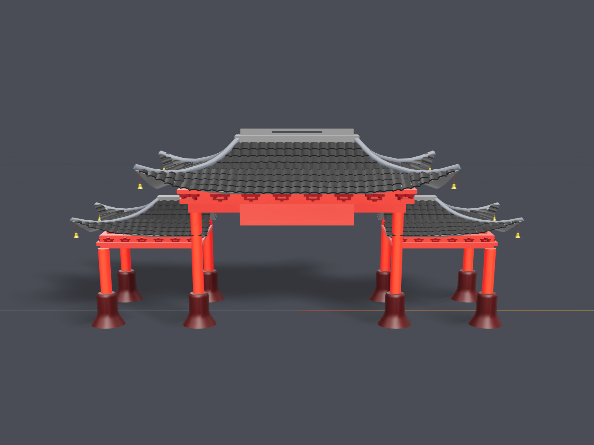
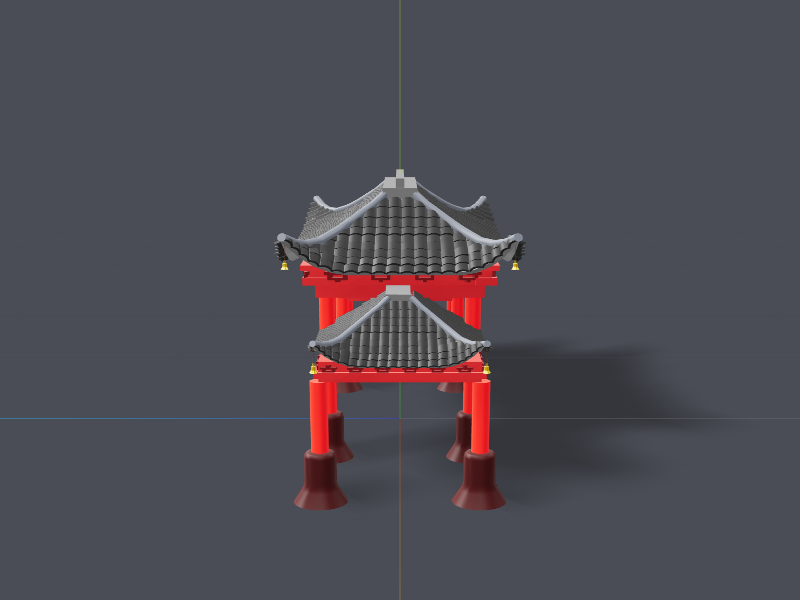
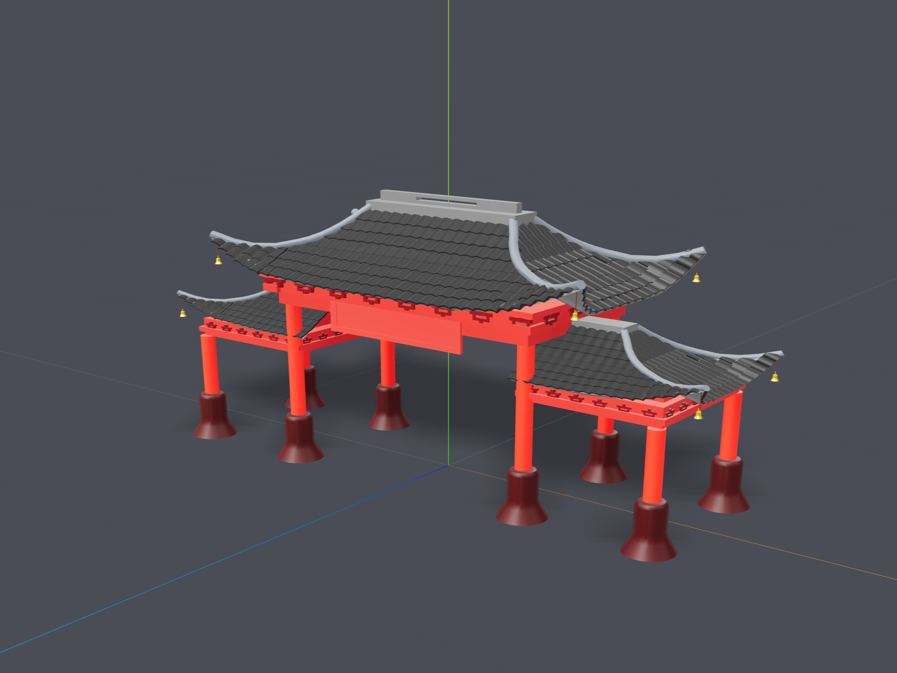

**What it is.** Despite the filename, this is **not a Japanese torii** — it is a Chinese
**paifang**: a three-bay ceremonial archway with stacked grey-tiled roofs and sweeping
upturned eaves, red columns on dark flared stone bases, bracket (dougong) detailing under
the eaves, a central name board, and small gold bells hanging from the eave tips.

**Art style.** Clean mid-poly hard-surface modelling with **no textures at all** — colour
comes entirely from 10 flat materials. Crisp geometry, correct proportions, genuinely
well-built. The roof tiles are modelled, not mapped.

**Material quality.** Flat untextured colour, which is both the weakness and the
opportunity: there is no baked lighting or detail to fight, so it will take whatever
material you give it.

**Mood fit — right shape, wrong colour.** The silhouette is exactly the Chapter 2 image:
an archway for the camera to pass through, framed by your two stone lions. But the
palette is tourist-bright — saturated orange-red columns against a clean grey roof. For
your mood it wants weathered dark timber, faded oxblood, and grime in the bracket
recesses. That is a one-material job, not a remodel.

**Verdict: the single best find in this batch.** 0.23 MB, zero texture VRAM, clean
base-centred pivot, already at metre scale, loads Y-up. **This closes the Chapter 2 gap.**

---

### B2. `broken_medieval_column_set` — 55.78 MB → 2.56 MB — **Needs optimization** — ✅ fills Chapter 3 ruins

| | |
|---|---|
| Triangles / vertices | 4,664 / 2,624 |
| Meshes / materials / textures | 4 / 4 / 12 |
| Texture resolutions | 12 × **4096²** PNG, 55.6 MB — **1021 MB VRAM** (→ 255 MB at 2048) |
| Animations | none |
| Rigged | no |
| Bounding box | 20.89 × 13.18 × 2.56 units |
| Scale to 1 u = 1 m | **×0.265** — tallest stump reads as ~3.5 m |
| Pivot | at base, horizontally offset (originRel x 0.94) — set is laid out to one side |
| Up axis | Y |
| Draw calls | 4 |

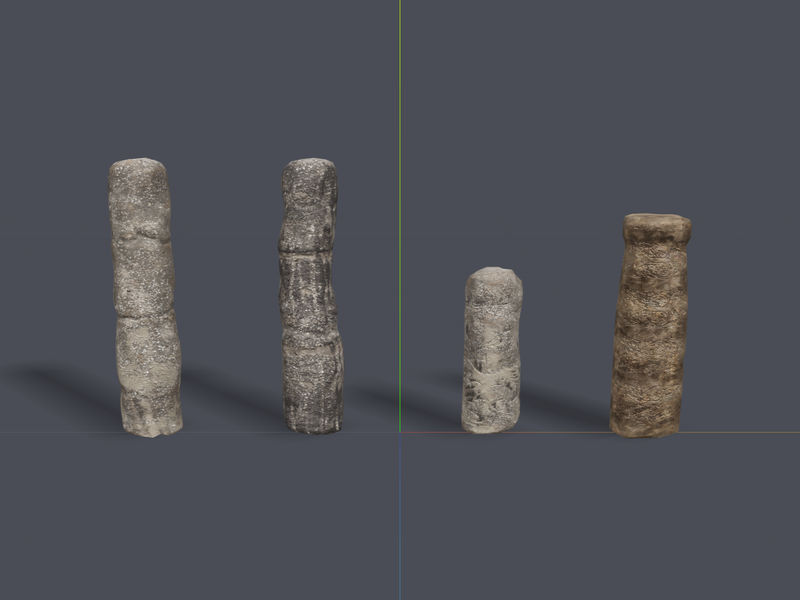
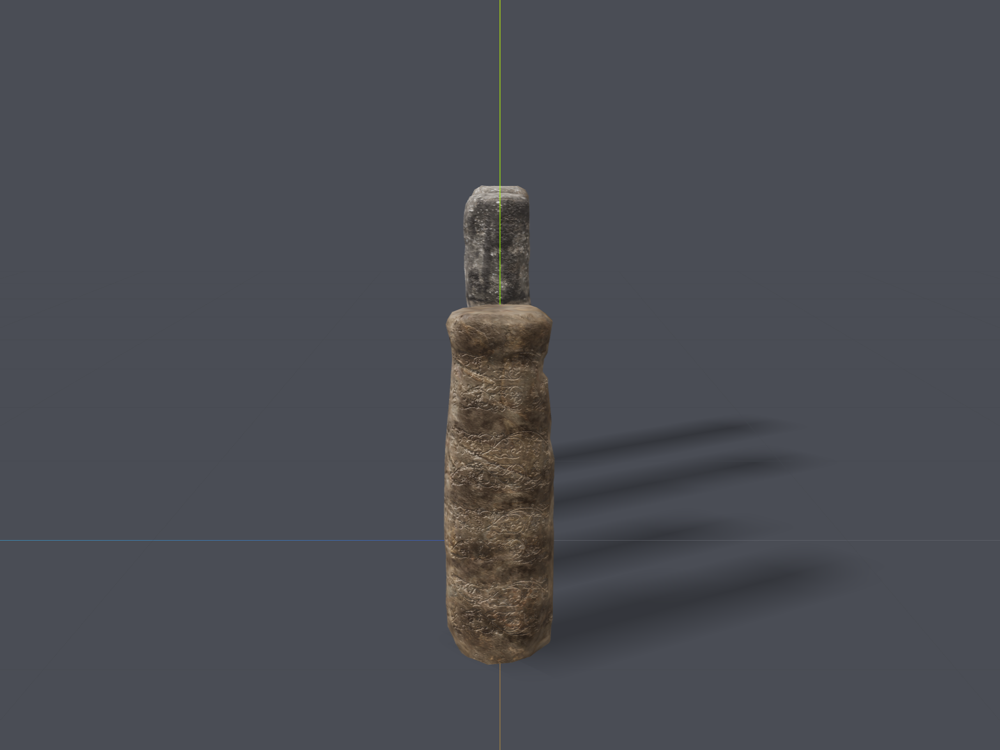
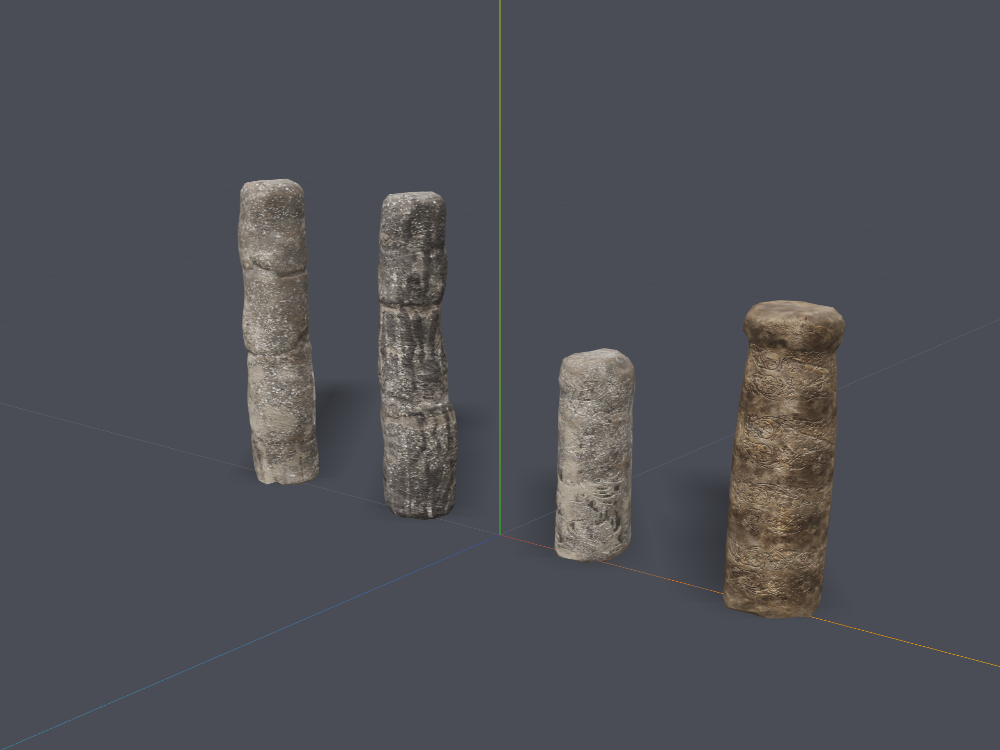

**What it is.** Four separate broken stone column stumps of varying height and damage,
laid out side by side — snapped shafts with ragged tops, heavy surface pitting, lichen
staining, and faint carved relief on two of them.

**Art style.** Photogrammetry or photo-sourced PBR. Full baseColor + normal +
metallicRoughness per column. The weathering is genuinely convincing: mineral streaking,
dark water staining, chipped edges.

**Material quality — the best in this batch**, and the reason the file was 55 MB.

**Mood fit — very good, with a caveat.** "Medieval" in the name implies European, and the
carved relief on two columns is non-specific rather than Chinese. But broken stone stumps
are close to culturally neutral, and under mist and gold rim-light nobody will read these
as European. The grey-brown weathered palette is already right.

**Concerns.** **12 textures at 4096² is 1 GB of VRAM for 4,664 triangles** — the worst
ratio in either batch. Optimization to 2048 brings it to 255 MB, which is still too much
for four background props; **drop these to 1024 (≈64 MB)** and you lose nothing at the
distance they will be seen. Being four separate meshes is a plus: scatter them
individually rather than placing the set as authored.

---

### B3. `stylized_rock` — 1.52 MB → 0.13 MB — **Ready** — ✅ fills the parallax-rock gap

| | |
|---|---|
| Triangles / vertices | 670 / 362 |
| Meshes / materials / textures | 1 / 1 / 3 |
| Texture resolutions | 3 × 1024² PNG — **16 MB VRAM** |
| Animations | none |
| Rigged | no |
| Bounding box | 0.143 × 0.222 × 0.107 units |
| Scale to 1 u = 1 m | **×6.76** — authored tiny (22 cm); scale up for a 1.5 m boulder |
| Pivot | offset inside bounds (y 0.44) — needs recentring |
| Up axis | Y |
| Draw calls | **1** |

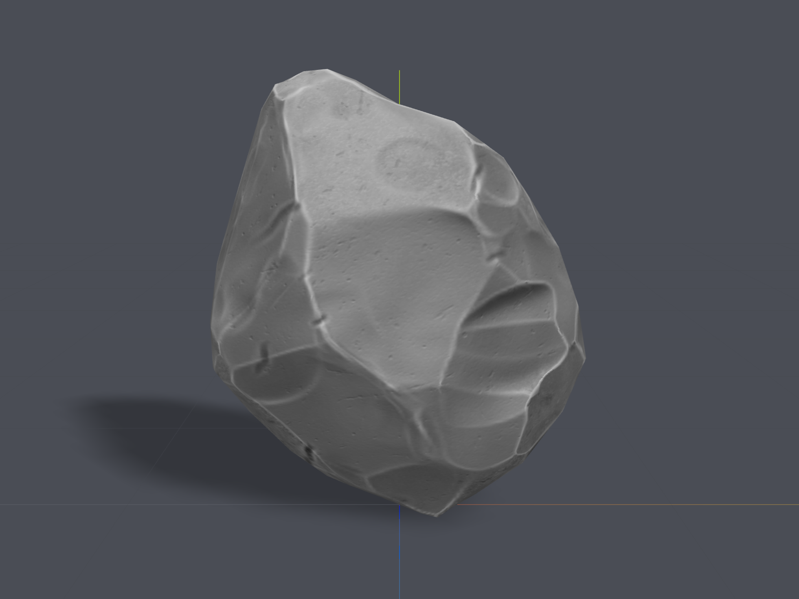
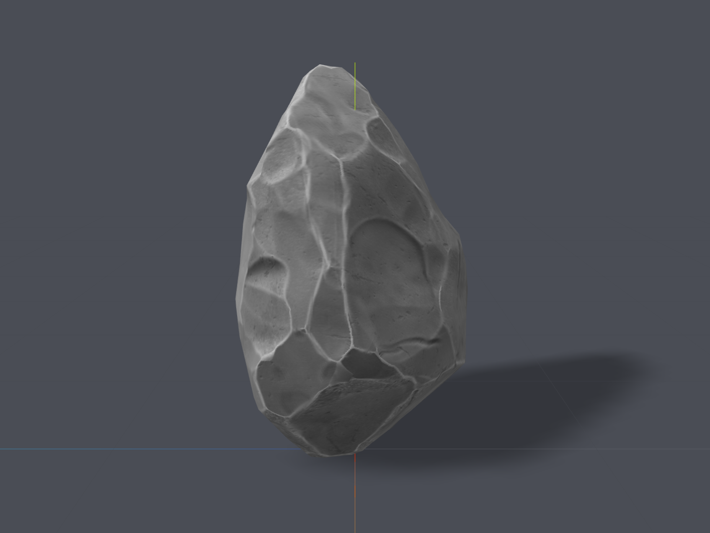
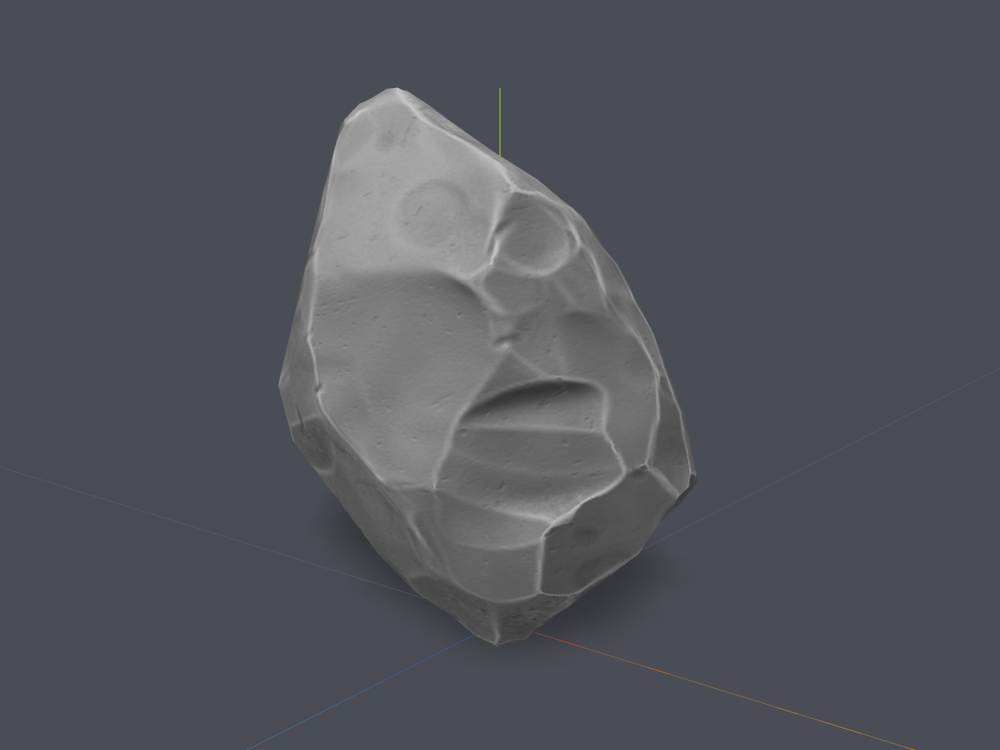

**What it is.** A single smooth grey boulder — faceted planes, soft worn edges, a few
shallow circular depressions, neutral stone colour.

**Art style.** Low-poly realistic. 670 triangles with a normal map doing the surface work.
Despite the "stylized" filename it reads as plain realistic rock, not painterly.

**Material quality.** Modest but correct: baseColor, normal, metallicRoughness and
occlusion at 1024². Flat neutral grey that takes coloured light well.

**Mood fit — excellent for its job.** This is not a hero asset and should not be one. It
is a 670-triangle, 0.13 MB, single-draw-call boulder you can instance fifty times into
foreground mist for parallax, which the Batch 1 report flagged as the biggest missing
piece. Neutral grey means it takes your gold rim-light and blue-grey fog cleanly.

**Concerns.** Only the pivot (recentre to base) and the ×6.76 scale-up. Both are config
entries, not edits. Instance it rather than placing copies.

---

### B4. `stylized_rock-2` — 26.34 MB → 0.31 MB — **Ready** — ⚠️ style clash

| | |
|---|---|
| Triangles / vertices | 3,754 / 2,136 |
| Meshes / materials / textures | 1 / 1 / 3 |
| Texture resolutions | 3 × **4096²** PNG, 26.2 MB — **255 MB VRAM** (→ 64 MB at 2048) |
| Animations | none |
| Rigged | no |
| Bounding box | 3.07 × 2.27 × 2.80 units |
| Scale to 1 u = 1 m | **×1.0** — already metres (2.3 m tall cluster) |
| Pivot | **at base, horizontally centred — clean** |
| Up axis | Y |
| Draw calls | **1** |

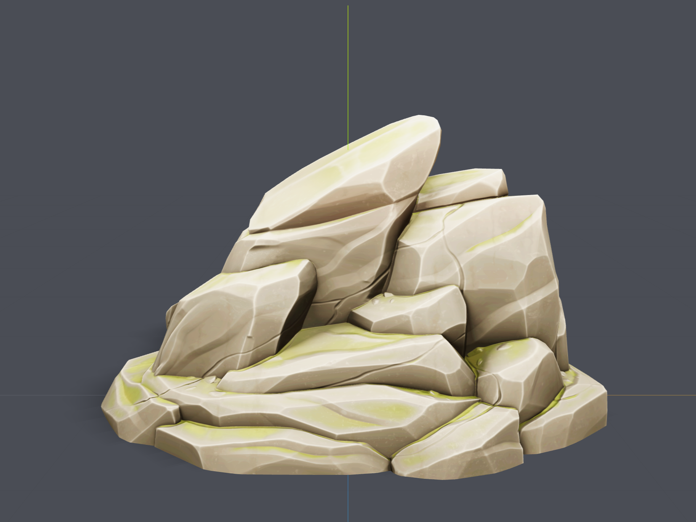
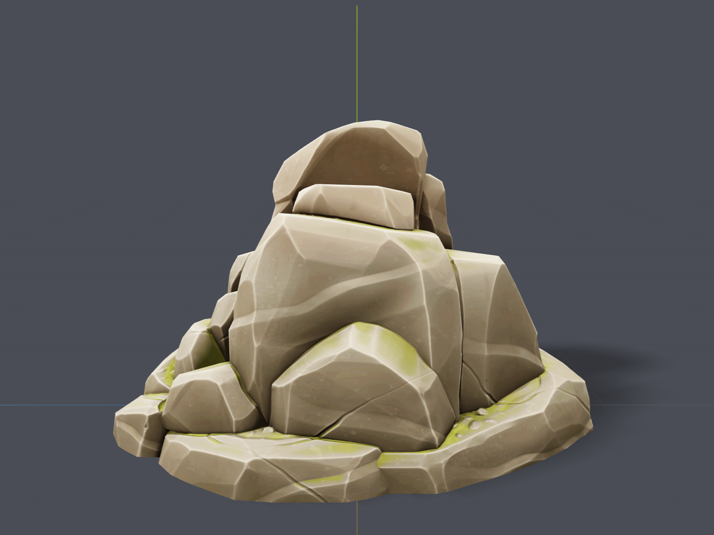


**What it is.** A cluster of angular slabs stacked into a low outcrop, with bright
yellow-green moss pooling in the crevices and along the base.

**Art style.** Genuinely stylized this time — **hand-painted, cel-shaded**, with painted
highlights and shadows baked into the albedo and crisp faceted planes. Closer to
*Genshin*'s or *Fortnite*'s rock language than to your photogrammetry temples.

**Material quality.** Clean and well-painted, but the lighting is **painted into the
texture**, so it will not respond correctly to your scene lighting — the painted
highlights will fight your real ones.

**Mood fit — this is the problem.** The painterly style and the acid yellow-green moss sit
badly next to the realistic stone lion, the photogrammetry pagoda and the realistic
`stylized_rock`. Mixing hand-painted and photoreal rock in one frame reads as a mistake.
Usable only if you commit to it exclusively and desaturate the moss hard.

**Verdict: technically Ready (0.31 MB, 1 draw call, clean pivot), but use `stylized_rock`
instead** unless you want to shift the whole site painterly.

---

### B5. `ancient_ruins` — 33.18 MB → 3.58 MB — **Needs optimization** — ⚠️ partly fills Chapter 3

| | |
|---|---|
| Triangles / vertices | 2,090 / 2,081 |
| Meshes / materials / textures | 27 / 3 / 9 |
| Texture resolutions | 9 × 2048² PNG, 33.0 MB — **171.6 MB VRAM** (unchanged by optimize) |
| Animations | none |
| Rigged | no |
| Bounding box | 11.35 × 5.88 × 9.27 units |
| Scale to 1 u = 1 m | **×1.0** — already metres |
| Pivot | at base, horizontally offset (z 0.64) |
| Up axis | Y |
| Draw calls | 27 → 3 after optimize |


**What it is.** A scatter kit of ruin pieces: a tall slender tower or lantern shaft topped
with a small tiered cap, a curved arched wall fragment broken into blocks, four standing
stones of graduating size, loose rubble, and a generous scatter of bright green grass tufts
and leafy sprigs. Three materials: `M_AncientRuins_Rocks`, `_Props`, `_Plants`.

**Art style.** Stylized low-poly with hand-painted-ish PBR textures — clean chamfered
forms, light grey stone, soft weathering. 2,090 triangles across 27 pieces, so each piece
is very cheap.

**Material quality.** Good for the style: baseColor + normal + metallicRoughness +
occlusion, all at 2048².

**Mood fit — right idea, wrong alphabet.** The *kit* structure is exactly what Batch 1
asked for: modular rubble you scatter to dress an intact building into a ruin. But the
carvings are unmistakably **Norse/Germanic runes** — angular futhark-style marks on the
standing stones and the arch blocks. In a Chinese-myth site these read as a mistake to
anyone who looks closely. The bright green grass is also off-palette.

**Usable if** you keep the plain rubble and arch blocks, drop or turn away the runic
stones, and desaturate the plants. **171.6 MB VRAM for 2,090 triangles** also needs
addressing — 1024² textures would quarter it with no visible loss at this polycount.

---

### B6. `stylized_rock-3` — 204.55 MB → 12.12 MB — **Too heavy** — ⚠️ partly fills Chapter 3

| | |
|---|---|
| Triangles / vertices | 2,705,902 → 257,700 / 1,405,885 |
| Meshes / materials / textures | 59 / 24 / **54** |
| Texture resolutions | 3 × 4096² + many 2048², 109.3 MB — **1271 MB VRAM** (→ **1058 MB**) |
| Animations | none |
| Rigged | no |
| Bounding box | 8.55 × 6.93 × 12.39 units |
| Scale to 1 u = 1 m | **×1.0** — already metres |
| Pivot | offset inside bounds (y 0.11) |
| Up axis | Y |
| Draw calls | 59 → 23 after optimize |


**What it is.** **Not a rock** — the filename is misleading. It is a complete **shrine
diorama**: three large standing monoliths rising from a raised, carved stone platform, with
a circular inscribed seal set into the floor, a short flight of steps, scattered boulders,
moss and grass clumps, and a small bowl or brazier at the base of the stones.

**Art style.** Realistic PBR, mid-to-high detail, with heavy green moss and lichen
weathering on pale limestone. Materials named `kaya1–6` (Turkish for *rock*) and `zemin`
(*ground*).

**Material quality.** High — full PBR with occlusion and emissive across 24 materials. It
looks like a genuine environment-art piece rather than a prop.

**Mood fit — strong, and the closest thing to a mystical site in either batch.** Standing
stones around an inscribed seal is exactly the kind of place a guardian would wake. The
pale-stone-and-moss palette works under mist. If the inscription were swapped for a
Chinese seal script motif it would be ideal.

**Concerns — severe.** **1058 MB of texture VRAM even after optimization**, across 54
textures and 23 draw calls. This single asset wants more texture memory than every other
model in both batches combined. Optimization did cut geometry 90% (2.7 M → 258 K), so the
triangles are fine; the textures are the problem. To use it you would need to cap textures
at 1024 and merge the 24 materials down to perhaps 4 — real art work, not a flag change.

**Rated Too heavy as delivered.** Promising enough to be worth that work if Chapter 3
matters to you.

---

### B7. `cool_staff` — 5.63 MB → 0.25 MB — **Needs optimization** — ❌ does **not** fill the Chapter 4 gap

| | |
|---|---|
| Triangles / vertices | 4,112 / 2,484 |
| Meshes / materials / textures | 2 / 2 / 3 |
| Texture resolutions | 3 × **4096²** PNG, 5.4 MB — **255 MB VRAM** (→ 64 MB at 2048) |
| Animations | none |
| Rigged | no |
| Bounding box | 4.16 × 2.36 × 2.87 units |
| Scale to 1 u = 1 m | **×0.433** — for a 1.8 m staff |
| Pivot | offset inside bounds; **root carries an arbitrary rotation** `(-0.335, 0.802, 0.426, 0.253)` |
| Up axis | Y, but the staff lies at an angle — needs a rotation fix, unlike every other asset |
| Draw calls | 2 |


**What it is.** A long, very slender staff in cream-white, tapering to a point at the base,
with an open **spiral lattice cage** at the head enclosing a warm amber-gold gem.

**Art style.** Clean stylized fantasy — smooth tubular forms, no surface wear, bright even
colour. Generic Western wizard-staff language.

**Material quality.** Fine but unremarkable; three 4096² maps doing very little for 4,112
triangles, which is why 255 MB of VRAM buys a plain white stick.

**Mood fit — wrong on every axis.** You asked for the **Ruyi Jingu Bang: dark iron shaft
with gold end-caps**, a heavy blunt weapon. This is a slim pale wizard staff with an open
filigree head and a glowing gem — the opposite silhouette, the opposite weight, the
opposite palette. Retexturing it dark iron would not help, because the spiral-cage head is
the recognisable part and it is wrong.

**Verdict: does not fill the Chapter 4 gap.** It is not a game rip and it is cheap, so it
is a marginally better placeholder than `staff_of_homa` on licensing grounds — but the
hero prop of your site still does not exist. Also note it is **the only asset in either
batch that needs a genuine rotation fix**.

---

### B8. `japanese_cherrybake` — 45.69 MB → 3.99 MB — **Not usable**

| | |
|---|---|
| Triangles / vertices | 57,194 → 40,312 / 82,369 |
| Meshes / materials / textures | 9 / 11 / 12 |
| Texture resolutions | 4096² + 2048², 43.0 MB — **268.7 MB VRAM** (→ 204.8 MB) |
| Extensions | `KHR_materials_unlit`, `_transmission`, `_ior`, `_emissive_strength` |
| Animations | none |
| Rigged | no |
| Bounding box | 200 × 200 × 200 units — **the sky dome**; the scene itself is ~25 m across |
| Scale to 1 u = 1 m | **×1.0** — stone lanterns measure 1.49 units, pagoda 15.4 |
| Pivot | fully centred (on the dome) |
| Up axis | Y |
| Draw calls | 42 → 11 after optimize |


**What it is.** A complete pre-built game scene: a three-tier **Japanese** pagoda with pale
gold roofs, six large cherry-blossom trees in full pink bloom, a stone stair flight, stone
lanterns, a paved ground patch — all enclosed in a 200-unit **night-sky photo dome** with
stars and an orange horizon glow.

**Art style.** Baked-lighting game scene. Every surface carries a pre-rendered lightmap in
its emissive channel, and the sky dome is `KHR_materials_unlit`.

**Material quality.** Competent, and the baked night lighting is genuinely pretty — warm
lantern pools against cool blue shadow.

**Mood fit — wrong culture, wrong palette.** This is Japanese, not Chinese: the pagoda form
(*gojūnotō*), the sakura, the stone lanterns (*tōrō*) are all unmistakably Japanese
iconography. For a site built on Chinese mythology that is a visible error, not a nuance.
The dominant colour is pale cherry pink — the furthest thing from ink, mist and aged gold.

**Also structurally awkward:** the enclosing sky dome has to be deleted before anything
else can be seen (it swallowed the first screenshot pass), and the baked lighting means the
scene carries its own night and will ignore yours.

**Verdict: not usable.** The individual stone lanterns could be salvaged, but you already
have a better lantern in `module_2_-_chinese_lantern`.

---

### B9. `kjwl` — 93.37 MB → 43.27 MB — **Not usable — COMMERCIAL GAME RIP**

| | |
|---|---|
| Triangles / vertices | 178,216 / 105,610 (unchanged — `--simplify false`, skinned) |
| Meshes / materials / textures | 1 mesh / 10 primitives / 6 materials / 12 textures |
| Texture resolutions | 12 × 2048² PNG, 47.0 MB — **223.4 MB VRAM** |
| Animations | **7 clips, 177 s total** — `AS_LYS_KJLDragon_Atk_00/01/02/06/07/08/09` (16.3–37.5 s) |
| Rigged | **yes — 1 skin, 511 joints** |
| Bounding box | 927 × 976 × 6514 units |
| Scale to 1 u = 1 m | **×0.00614** — centimetre-authored; for a 40 m dragon |
| Pivot | offset inside bounds |
| Up axis | Y |
| Draw calls | 10 |


**What it is.** Kang Jin Long (亢金龙) from **Black Myth: Wukong** — a long serpentine
Eastern dragon with a maned head, whiskers, four clawed limbs and a broad finned tail,
rigged on a 511-joint production skeleton with seven full combat animations.

**Art style.** Shipped AAA game asset. It renders near-white in the neutral preview because
its material setup expects the game's own shaders.

**Why it is flagged.** See the rips section above — Unreal internal naming
(`SK_`/`T_`/`M_`/`AS_` prefixes), the `from-the-vault` folder, a named boss character, and
seven authored combat clips. There is no ambiguity here.

**Mood fit — irrelevant.** On pure craft this would be the best asset in the project: it is
a genuine Black Myth dragon with real animation, which is precisely the look you are
chasing. **You cannot use it.** Using shipped game assets on a public site is a copyright
problem regardless of attribution.

**Also the worst compressor in either batch** — only −54%, because seven clips of
511-joint animation dominate the file and keyframe data does not compress.

**Verdict: delete, or move to `_rejected/`.**

---

## Impact on the existing set

Your "no commercial game rips" rule applies retroactively, and it **breaks one asset
already in `public/models/`**:

| Asset | Source | Status |
|---|---|---|
| `staff_placeholder.glb` | **Genshin Impact** — Staff of Homa | ✅ **removed 2026-10-26** — moved to `_rejected/`, row dropped from `src/config/models.js` |
| `black_myth_wukong_-_ling_xu_zi_static.glb` | **Black Myth: Wukong** — Lingxuzi | ✅ already in `_rejected/` |
| `kjwl.glb` | **Black Myth: Wukong** — Kang Jin Long | ❌ new, reject |

Chapter 4 therefore has **no asset at all** — not a wrong one, none. `cool_staff` is the
only licensable staff in the project and it is the wrong weapon.

**Done:** `staff_placeholder.glb` has been moved to `_rejected/` and its row removed from
`src/config/models.js`. The shipping set is now **8 models, 15.60 MB**, and
`chapterBudget(4)` correctly reports zero models.


---

# Story fit — full set (22 models)

Supersedes the Batch 1 story-fit table above. Covers all 22 models analysed, and applies
the rule that **no commercial game rips may be used**.

| Chapter | Models now available | Confidence | Status |
|---|---|---|---|
| **1. Ink Void opening** | `dragon_with_pearl` (ink silhouette) · `chinese_dragon_fan` | Medium | Unchanged. Still mostly shader and typography work; the untextured dragon sculpt as a black silhouette remains the strongest option. |
| **2. Mountain Gate** | **`torri_gate`** (the gate) · `stone_lion` ×2 · `module_2_-_chinese_lantern` | **High** | ✅ **Gap closed.** The paifang stands between the mirrored lions, lanterns receding into mist behind. Needs only a recolour to weathered timber. |
| **3. Temple Ruins** | **`broken_medieval_column_set`** · **`ancient_ruins`** · `chinese_pagoda` · `fantasy_style_tree` · `module_2_-_chinese_lantern` · (`stylized_rock-3` if tamed) | **High** | ✅ **Gap closed.** Scatter the four column stumps and the rubble around the intact pagoda to read as abandoned. Keep the runic stones out of shot. |
| **4. The Legendary Staff** | **nothing** | **None** | ❌ **Worse than before.** The Genshin rip has been pulled from `public/models/`; `cool_staff` is the wrong weapon entirely. The hero moment has no asset, and this chapter cannot be built until one is sourced. |
| **5. The Guardian awakening** | `chinese_dragon` (animated, 8 s loop) | Medium | ⚠️ **Weakened.** Both Black Myth creatures are now barred, so the animated dragon is carrying this chapter alone. It works, but there is no second beat. |
| **6. The Summit pagoda finale** | `jinshan_temple_cishou_pagoda` (distant) · `chinese_pagoda` (close) · `module_2_-_chinese_lantern` | **High** | Unchanged and well covered. |
| **All chapters — parallax** | **`stylized_rock`** (instance it) · (`stylized_rock-2` if going painterly) | **High** | ✅ **Gap closed** for foreground boulders. 670 tris, 0.13 MB, one draw call — instance freely. |

## Gap status

| Gap | Before Batch 2 | Now | Filled by |
|---|---|---|---|
| Chapter 2 — a gate | ❌ missing | ✅ **filled** | `torri_gate` (a Chinese paifang despite the name) |
| Chapter 3 — ruins | ❌ missing | ✅ **filled** | `broken_medieval_column_set` + `ancient_ruins` |
| Chapter 4 — Ruyi Jingu Bang | ⚠️ wrong placeholder | ❌ **still open, now empty** | nothing — and the old placeholder is disqualified |
| Foreground rocks | ❌ missing | ✅ **filled** | `stylized_rock` |
| Cliffs / large rock faces | ❌ missing | ❌ **still open** | the new rocks are boulders, not cliff walls |

## What to search for next

**Priority 1 — Chapter 4, the hero staff (still the critical gap).**
`Ruyi Jingu Bang` · `jingu bang` · `golden cudgel` · `monkey king staff` · `ruyi staff`.
Dark iron or black shaft, gold or brass end-caps, engraved bands, under 20 K triangles.
**Filter out anything whose description mentions Black Myth or a game name** — check the
texture and material names before downloading, the way `kjwl` gave itself away. A plain
metal rod with two decorated caps is simple enough that a clean original model is easy to
find, or to model yourself in an hour.

**Priority 2 — cliffs and rock walls (newly the second gap).**
`cliff face` · `rock wall` · `karst cliff` · `canyon wall` · `stylized cliff`.
You now have boulders for near-field parallax but nothing to build a mountain pass or a
gorge from. Prefer realistic, neutral-grey, under 50 K triangles, 1024–2048 textures.

**Priority 3 — a second Chapter 5 creature.**
With both Black Myth models barred, consider `temple guardian statue` ·
`stone warrior statue` · `qilin statue` · `nio guardian`. A *statue* that the camera
reveals rather than an animated creature sidesteps both the licensing problem and the
animation problem — and a dark stone guardian suits the palette better than the pure-white
Lingxuzi ever did.

**Still nice to have:** `incense burner` / `ding cauldron`, `stone stele` / `bixi tortoise`.

**Licensing check for every future download:** open the file and look at the material and
texture names before using it. Engine-internal prefixes (`T_`, `M_`, `SK_`, `SM_`, `AS_`,
`BP_`), a named character from a shipped game, or folder names containing "vault", "rip",
"extracted" or "datamined" all mean the asset is not licensable. Generic names
(`Material.001`, `defaultMat`, `rock_MAT`) are the good sign.
